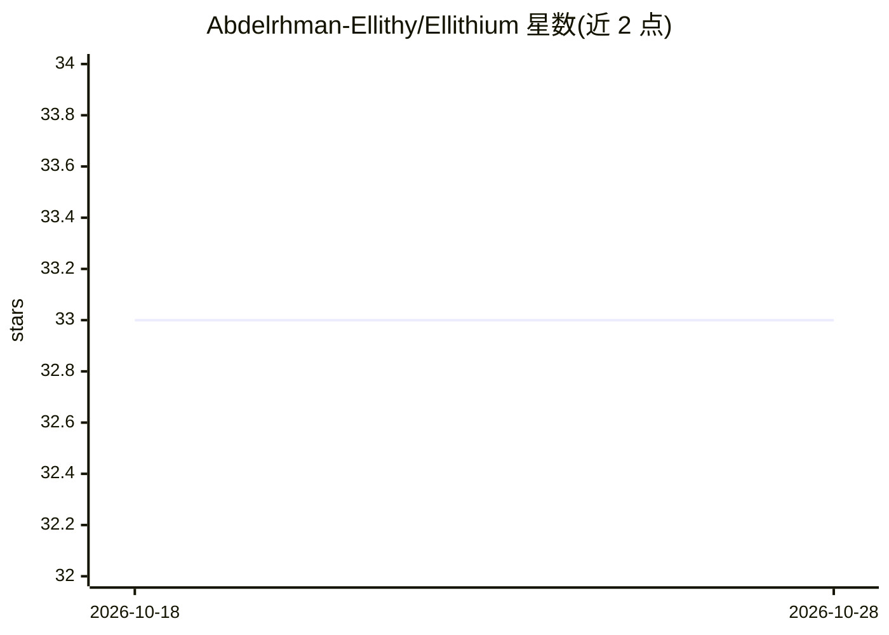

# Abdelrhman-Ellithy/Ellithium

⭐ 33 · Java · Apache-2.0 · 推送 2026-10-26 · [GitHub](https://github.com/Abdelrhman-Ellithy/Ellithium) · [官网](https://abdelrhman-ellithy.github.io/ellithium.github.io/) · 个人维护

**面向 SDET 的 Java 统一测试自动化框架，含 AI 自愈与 LLM 生成**

基于 Selenium/Appium/TestNG/Cucumber/Rest Assured 的统一测试自动化框架，覆盖 Web、移动（Android/iOS）、API 及 SQL/NoSQL 数据库测试，支持 BDD、并行执行、跨浏览器、Allure 报告与 BrowserStack/LambdaTest/Sauce Labs 云真机。AI 能力包括三层级联的定位器自愈（算法/本地嵌入模型/LLM）、Codegen 录制、自然语言会话内测试扩展、手工用例转脚本与 LLM 测试生成，支持 8 类 LLM 提供商含本地 Ollama。以 Maven 依赖接入，需 JDK 25。

## 筛选速览

| 维度 | 判定 | 备注 |
|---|---|---|
| AI 角色 | `ai-enhanced` | 去掉 AI 部分产品仍成立 |
| 许可风险 | `permissive` | Apache-2.0 |
| 部署形态 | `None` |  |
| 模型依赖 | local-ok | 支持本地模型 |
| 硬件要求 | — | 无带数字的原话,不猜 |
| 安装摩擦 | `low` | 无编译、无系统依赖或容器化 |
| 成熟度 | — | 结构信号不足 |

## 能力要点

- 三层级联定位器自愈（算法启发式/本地嵌入模型/LLM）
- LLM 测试生成、BDD Feature 生成与手工用例转脚本
- Web/移动/API/SQL/NoSQL 全覆盖，支持 8 类 LLM 提供商（含本地 Ollama）
- Codegen 录制器生成 TestNG 类或 Page Object，支持 iframe/Shadow DOM/Appium

## 适用场景

- 用 Maven 项目搭建 Web/移动/API/数据库统一自动化测试
- 页面元素变动时依靠自愈机制维持测试可运行
- 把 JSON 手工测试用例批量转为 TestNG 与 BDD 脚本

## 场景标签

`浏览器自动化` · 领域:效率与自动化

## 证据(README 行号)

> L54: |AI Self-Healing|Codegen Recorder|LLM Test Generation|Live In-Session Test Extension|Manual Test → Script|BDD Featu
> L76: **🔧 AI Self-Healing** — When a locator breaks at runtime, Ellithium recovers automatically through a three-tier cas
> L125: |OpenAI|Anthropic|Gemini|DeepSeek|Groq|Qwen|Local / Ollama|Custom Endpoint|

## 星数曲线

2026-10-18 33 → 2026-10-28 33（+0）

---
*卡片 v1 · prompt 1.4 · 生成 2026-10-25 · 置信度 high · 依据 README sha `4b5a4c51e93f` · [字段定义](../../DATASET.md)*
