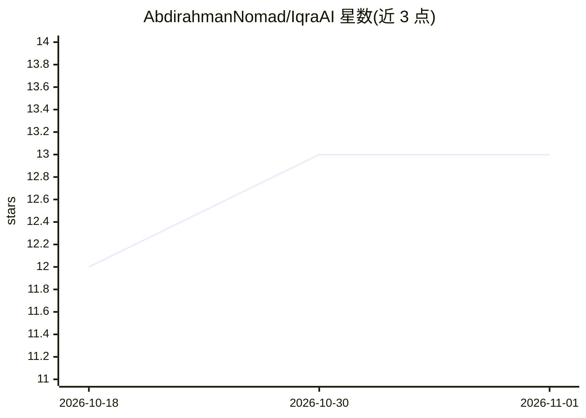

# AbdirahmanNomad/IqraAI

⭐ 13 · Python · MIT · 推送 2026-02-16 · [GitHub](https://github.com/AbdirahmanNomad/IqraAI) · [官网](https://abdirahman.net) · 个人维护

**古兰经语音识别应用：背诵转写、对经纠错与多语翻译**

基于 Tarteel whisper-base-ar-quran（针对古兰经阿拉伯语微调的 Whisper 模型）的语音识别应用：转写背诵音频并与权威经文比对，以绿/红/黄标示正确、错漏与多读的词句；提供 Iqra 背诵模式（选定节次、录制、比对）、Hijaiyah 字母发音分类练习，以及阿拉伯语、英语、索马里语、阿姆哈拉语、斯瓦希里语翻译（经 Quran Enc API，需联网）。以 Gradio Web 应用与 CLI 两种形式提供，可导出 TXT/JSON/SRT。首次运行自动下载约 500MB 模型。

## 筛选速览

| 维度 | 判定 | 备注 |
|---|---|---|
| AI 角色 | `ai-native` | 本体是模型或模型工具 |
| 许可风险 | `permissive` | MIT |
| 部署形态 | `library` | 以包/库形式分发 |
| 模型依赖 | — | README 未给出锁定关系 |
| 硬件要求 | — | 无带数字的原话,不猜 |
| 安装摩擦 | `low` | 无编译、无系统依赖或容器化 |
| 成熟度 | — | 结构信号不足 |

## 能力要点

- 古兰经阿拉伯语微调 Whisper 模型做 ASR 转写
- 逐词经文比对：绿/红/黄标示正确、错漏与多读
- Iqra 背诵模式与 Hijaiyah 字母分类练习
- 5 种语言的经文翻译与 TXT/JSON/SRT 导出

## 适用场景

- 背诵古兰经后录音核对，逐词定位错漏
- 按选定章节做背诵练习并查看翻译
- 初学者练习 Hijaiyah 字母发音

## 场景标签

`语音识别` · 领域:感知与多模态

## 证据(README 行号)

> L17: - **ASR** — Tarteel whisper-base-ar-quran (fine-tuned for Quranic Arabic)
> L18: - **Verse matching & mistake detection** — Green (correct), red (missed/incorrect), yellow (extra)

## 星数曲线

2026-10-18 12 → 2026-11-01 13（+1）

---
*卡片 v1 · prompt 1.4 · 生成 2026-11-01 · 置信度 mid · 依据 README sha `3334f60e5282` · [字段定义](../../DATASET.md)*
