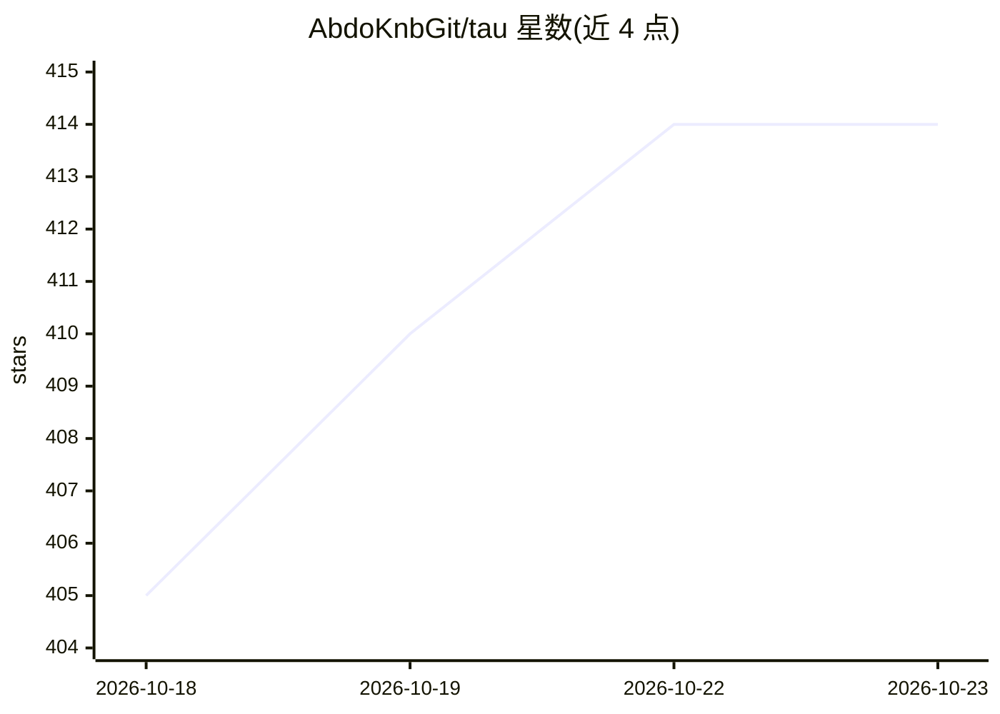

# AbdoKnbGit/tau

⭐ 414 · TypeScript · 推送 2026-10-21 · [GitHub](https://github.com/AbdoKnbGit/tau) · 个人维护

**自适应编码 Agent 客户端：30 个模型供应商原生接入**

终端中运行的编码 Agent harness：内置工具、技能、子 Agent、MCP 服务器、LSP 与 hooks 组成完整 agent loop，通过原生适配器直连 30 个模型供应商 API（非路由/代理层）。特色机制包括持久 Python kernel（单轮执行整段工作流以降低成本）、影子 git 仓库快照与时间回溯、终端 LaTeX/图表渲染、浏览器自动化、常驻命名子 Agent、Wi-Fi/隧道远程控制与共享会话、跨供应商的上下文与故障回退管理。npm 一键安装，需 Node.js 20.19+/22.12+ 与 Git，可选构建原生 helper 需 Go。

## 筛选速览

| 维度 | 判定 | 备注 |
|---|---|---|
| AI 角色 | `ai-ecosystem` | LLM/agent 周边工具 |
| 许可风险 | `none` | — |
| 部署形态 | `library` | 以包/库形式分发 |
| 模型依赖 | — | README 未给出锁定关系 |
| 硬件要求 | — | 无带数字的原话,不猜 |
| 安装摩擦 | `low` | 无编译、无系统依赖或容器化 |
| 成熟度 | — | 结构信号不足 |

## 能力要点

- 30 个供应商原生适配器，直连各自 API，非路由层
- 持久 Python kernel：整段工作流单轮执行，状态跨 cell 保留
- 影子 git 快照：保存/对比/恢复工作区状态
- 常驻命名子 Agent，可继续派发任务，各用独立供应商/模型

## 适用场景

- 在终端里让 AI Agent 完成编码与仓库管理任务
- 多供应商切换使用不同模型并做故障回退
- 用手机远程查看和审批正在运行的 Agent 会话
- 批量处理 CSV/代码库分析等可写成 Python 单元的工作流

## 场景标签

`编码 Agent` `浏览器自动化` · 领域:效率与自动化

## 证据(README 行号)

> L11: Tau is an adaptive coding harness that is simple to use. It costs less to run, gives you higher quality output, and
> L86: Everything a full agent loop needs is built in: tools, skills, subagents, MCP servers, LSP and hooks. It all works 

## 星数曲线

2026-10-18 405 → 2026-10-23 414（+9）

---
*卡片 v1 · prompt 1.4 · 生成 2026-10-21 · 置信度 high · 依据 README sha `98a6a2d8831d` · [字段定义](../../DATASET.md)*
