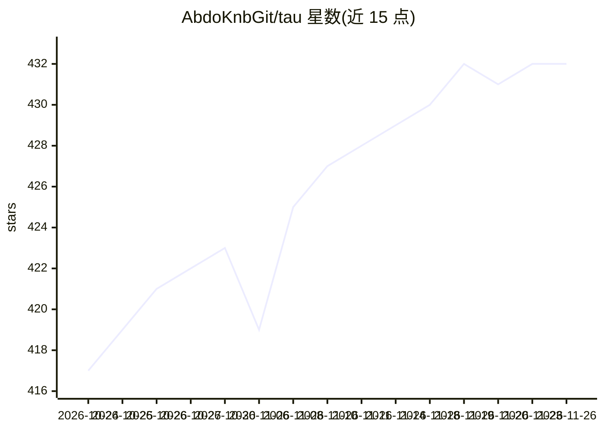

# AbdoKnbGit/tau

⭐ 432 · TypeScript · 推送 2026-11-21 · [GitHub](https://github.com/AbdoKnbGit/tau) · 个人维护

**面向开发者的自适应编码 agent，内置 30 家模型商适配器**

Tau 是一个终端运行的编码 agent harness，通过 npm 安装后执行 `tau` 启动，`/login` 选择提供商即可使用。内置 tools、skills、subagents、MCP、LSP 与 hooks 组成的完整 agent 循环；自带搜索、文件读取、Bash 安全分类、Python 持久内核、终端 Mermaid 绘图、浏览器自动化与快照回滚工具。要求 Node.js（推荐 24 LTS）、Git、Bash 与 `gh`。子代理可配置独立提供商/模型，支持降级恢复与跨提供商上下文适配。

## 筛选速览

| 维度 | 判定 | 备注 |
|---|---|---|
| AI 角色 | `ai-ecosystem` | LLM/agent 周边工具 |
| 许可风险 | `none` | — |
| 部署形态 | `library` | 以包/库形式分发 |
| 模型依赖 | — | README 未给出锁定关系 |
| 硬件要求 | — | 无带数字的原话,不猜 |
| 安装摩擦 | `low` | 无编译、无系统依赖或容器化 |
| 成熟度 | — | 结构信号不足 |

## 能力要点

- 30 个提供商原生适配器，直连各提供商 API，无中间代理
- 完整 agent 循环内置：tools、skills、subagents、MCP、LSP、hooks
- 持久 Python 内核单回合执行批处理工作流并返回结果
- 影子 git 快照实现工作树保存、diff 与恢复

## 适用场景

- 多提供商间切换并管理编码 agent 的模型与成本
- 让 agent 批量分析 CSV/代码库并在单回合出结果
- 通过手机远程查看并继续本机 agent 会话
- 子代理并行搜代码、按需指定各自的提供商与模型

## 场景标签

`编码 Agent` · 领域:编码与开发

## 证据(README 行号)

> L11: Tau is an adaptive coding harness that is simple to use. It costs less to run, gives you higher quality output, and
> L61: 30 providers with native adapters. Not a routing layer, not a translation proxy. Each provider speaks its own API t
> L65: Everything a full agent loop needs is built in: tools, skills, subagents, MCP servers, LSP and hooks. It all works 

## 星数曲线

2026-10-24 417 → 2026-11-26 432（+15）

---
*卡片 v1 · prompt 1.4 · 生成 2026-11-25 · 置信度 high · 依据 README sha `89de276def12` · [字段定义](../../DATASET.md)*
