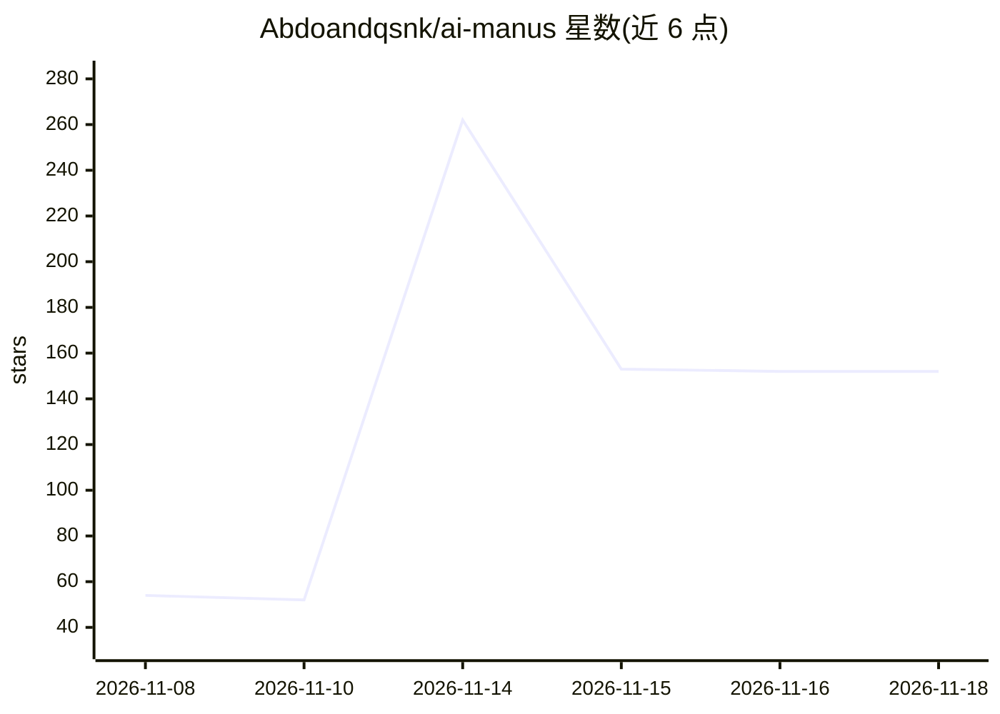

# Abdoandqsnk/ai-manus

⭐ 152 · Python · Apache-2.0 · 推送 2026-11-15 · [GitHub](https://github.com/Abdoandqsnk/ai-manus) · 个人维护

**面向日常小任务的自主 AI Agent：代跑代码、控浏览器**

README 以营销化文案描述一个自主 AI Agent：可自主编写并执行脚本、控制浏览器（导航网页、填表、采集信息），并以个人助手形式在后台执行多步任务，定位为家庭、学习与轻量办公场景的辅助工具，而非企业平台。描述了兼容性表（最低 4GB 内存、双核 CPU）与六步上手流程，但未给出具体的安装命令、技术栈细节或 API 接入方式，仅提供 Download 链接与促销码。用户通过自然语言指令委托任务，由 Agent 产出代码运行与浏览器操作结果。

## 筛选速览

| 维度 | 判定 | 备注 |
|---|---|---|
| AI 角色 | `ai-native` | 本体是模型或模型工具 |
| 许可风险 | `permissive` | Apache-2.0 |
| 部署形态 | `None` |  |
| 模型依赖 | — | README 未给出锁定关系 |
| 硬件要求 | — | 无带数字的原话,不猜 |
| 安装摩擦 | `low` | 无编译、无系统依赖或容器化 |
| 成熟度 | — | 结构信号不足 |

## 能力要点

- 自主执行代码与控制浏览器完成多步任务
- 以个人助手形式在后台待命执行委托任务
- 脚本与浏览器操作可在同一任务流中衔接

## 适用场景

- 让学生组织研究笔记、跑小脚本
- 让 Agent 代替人工浏览网页采集与汇总信息
- 远程工作者委托重复性的表单填写与页面检查

## 场景标签

`AI 助手` `浏览器自动化` · 领域:效率与自动化

## 证据(README 行号)

> L10: - **Autonomous Code Execution:** Manus AI agent runs code on its own to complete tasks, so you can focus on decisio
> L18: Manus is an autonomous AI agent designed to run code and control a browser on your behalf. Instead of acting like a

## 星数曲线

2026-11-08 54 → 2026-11-18 152（+98）

---
*卡片 v1 · prompt 1.4 · 生成 2026-11-17 · 置信度 mid · 依据 README sha `0b7364c4f502` · [字段定义](../../DATASET.md)*
