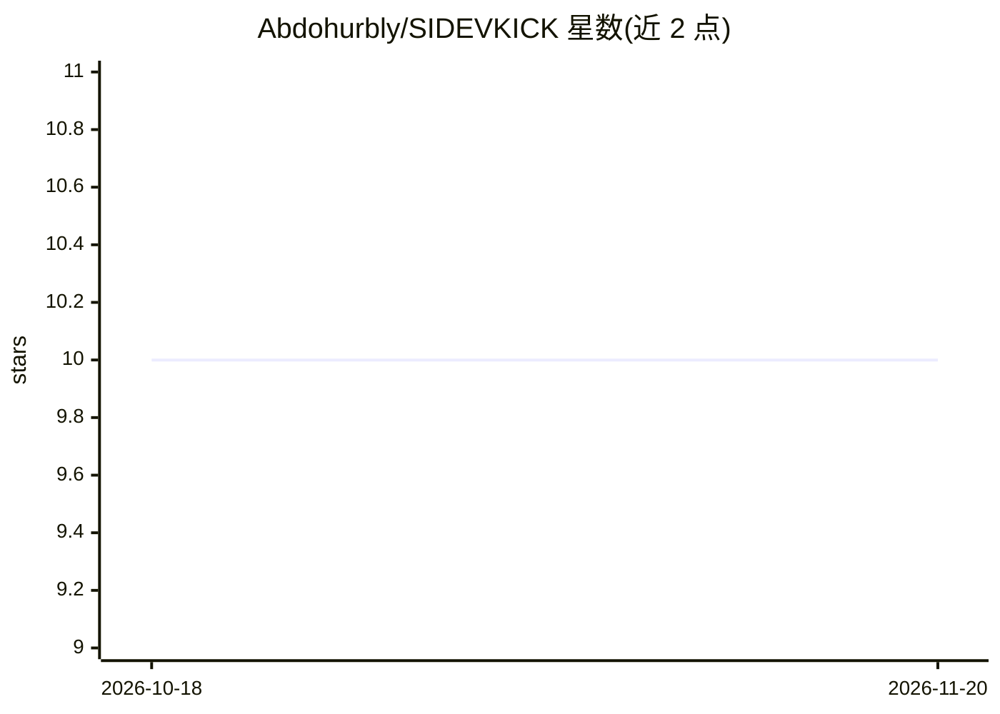

# Abdohurbly/SIDEVKICK

⭐ 10 · Python · MIT · 推送 2026-02-12 · [GitHub](https://github.com/Abdohurbly/SIDEVKICK) · 个人维护

**面向开发者的本地 AI 编码助手工具**

SIDEVKICK 是一个本地开发工作流的 AI 辅助工具，提供代码生成、重构、解释与建议、聊天界面、内置 Monaco 代码编辑器、文件浏览器、带 diff 视图的 AI 建议应用（文件编辑、创建文件/目录、执行 shell 命令）、基础 Git 操作与 Web 项目实时预览。架构为 FastAPI 后端加 React (TypeScript) 前端；上下文支持 RAG（FAISS + SentenceTransformers 语义检索）或静态分析两种方式，可在 UI 中切换。安装需 Python 3.9+、Node.js 18+、Git，并自行配置所选模型的 API key。

## 筛选速览

| 维度 | 判定 | 备注 |
|---|---|---|
| AI 角色 | `ai-native` | 本体是模型或模型工具 |
| 许可风险 | `permissive` | MIT |
| 部署形态 | `library` | 以包/库形式分发 |
| 模型依赖 | locked-api |  |
| 硬件要求 | — | 无带数字的原话,不猜 |
| 安装摩擦 | `low` | 无编译、无系统依赖或容器化 |
| 成熟度 | — | 结构信号不足 |

## 能力要点

- 支持 Google Gemini、OpenAI、Anthropic 三类模型并可在配置面板动态切换
- RAG（FAISS + SentenceTransformers）与静态分析双路径的代码上下文系统
- AI 建议经 diff 视图审核后应用，包括文件编辑与 shell 命令执行
- FastAPI 后端 + React/TypeScript 前端，含 Git 基础操作与实时预览

## 适用场景

- 让 AI 生成、重构和解释本地项目代码
- 在带编辑器的界面中审核并应用 AI 提交的变更
- 对大型项目做语义检索以缩小发送给模型的上下文

## 场景标签

`代码生成` `编码 Agent` · 领域:编码与开发

## 证据(README 行号)

> L7: SIDEVKICK is a tool designed to assist developers by integrating AI capabilities directly into their local developme
> L15: - **AI-Powered Coding Assistance:** Leverage models from Google Gemini, OpenAI, or Anthropic for code generation, r
> L20: - **Backend API:** A robust FastAPI backend to handle AI interactions and file operations.

## 星数曲线

2026-10-18 10 → 2026-11-20 10（+0）

---
*卡片 v1 · prompt 1.4 · 生成 2026-11-20 · 置信度 high · 依据 README sha `efc69dd40f55` · [字段定义](../../DATASET.md)*
