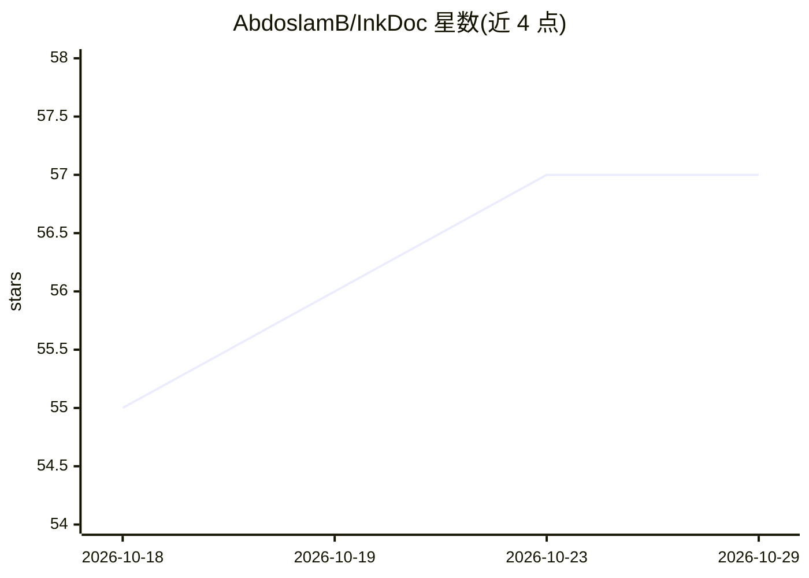

# AbdoslamB/InkDoc

⭐ 57 · Python · MIT · 推送 2026-10-15 · [GitHub](https://github.com/AbdoslamB/InkDoc) · [官网](https://abdoslamb.github.io/InkDoc) · 个人维护

**本地多引擎文档转 Markdown 的跨平台桌面应用**

面向需要将各类文档转为 Markdown 的用户的桌面工作台，同时内嵌本地 REST API。聚合四个转换引擎：MarkItDown（内置，日常 Office/HTML/媒体）、Docling（可选引擎包，深度版面分析与表格重建）、Markit（内置多格式提取器，覆盖 EPUB/YAML/Notebook）与 GLM-OCR（可选下载约 1.45GB，经 llama.cpp 本地运行的 0.9B 视觉 OCR 模型），支持 Auto 按文件自动分派。转换异步完成并自动保存，带防冲突命名。Windows/macOS(Apple Silicon)/Linux 提供预构建桌面包，无需 Python。限制：macOS 仅原生支持 Apple Silicon，构建未签名。

## 筛选速览

| 维度 | 判定 | 备注 |
|---|---|---|
| AI 角色 | `ai-enhanced` | 去掉 AI 部分产品仍成立 |
| 许可风险 | `permissive` | MIT |
| 部署形态 | `desktop` | 安装包/桌面程序 |
| 模型依赖 | — | README 未给出锁定关系 |
| 硬件要求 | — | 无带数字的原话,不猜 |
| 安装摩擦 | `medium` | 含编译或系统依赖之一 |
| 成熟度 | — | 结构信号不足 |

## 能力要点

- 四引擎转换管线（MarkItDown/Docling/Markit/GLM-OCR）+ Auto 自动分派
- PDF 缺文本检测：静默不完整转换会提示并支持一键修复
- 内嵌 FastAPI 本地 REST API，支持流式上传、URL 转换与 headless 服务器模式
- Ed25519 离线签名验证的更新流程与 SHA-256 校验

## 适用场景

- 把 Word/Excel/PPT/HTML 等文档批量转成 Markdown 供 LLM 使用
- 扫描件与照片通过本地 OCR 引擎提取文字和表格
- 在 CI/CD 或程序化管线中通过本地 REST API 调用转换

## 场景标签

`文档解析` `OCR` · 领域:知识与检索

## 证据(README 行号)

> L116:  Intelligently dispatches between Microsoft MarkItDown (fast everyday documents), Docling (deep layout analysis an
> L151: > MarkItDown and InkDoc's Markit extractors are pre-bundled in all InkDoc distributions. Docling is packaged as an
> L158: GLM-OCR (zai-org, 0.9B parameters, MIT license) is a small vision-language model built for OCR. InkDoc runs it loc

## 星数曲线

2026-10-18 55 → 2026-10-29 57（+2）

---
*卡片 v1 · prompt 1.4 · 生成 2026-10-24 · 置信度 low · 依据 README sha `cdf10c1e5558` · [字段定义](../../DATASET.md)*
