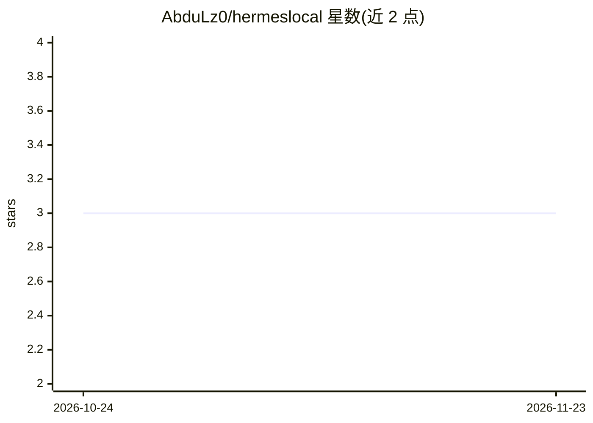

# AbduLz0/hermeslocal

⭐ 3 · Shell · NOASSERTION · 推送 2026-10-12 · [GitHub](https://github.com/AbduLz0/hermeslocal) · 个人维护

**Linux 上一键安装本地 Hermes Agent + Ollama + Qwen 9B**

面向 Ubuntu/Debian 系 Linux 桌面初学者的 Bash 安装脚本：检测发行版与前置条件，安装并启用 Ollama 服务，拉取 qwen3.5:9b 模型，以非交互模式安装 Hermes Agent，并配置其指向 Ollama 的本地 OpenAI 兼容端点，最后运行验证检查与 hermes doctor。修改已有配置前会做时间戳备份；要求 systemd、sudo 权限与约 12 GB 磁盘、16 GB 内存（建议）。不支持无 systemd 的 WSL，也不做网络暴露或 API key 管理。

## 筛选速览

| 维度 | 判定 | 备注 |
|---|---|---|
| AI 角色 | `ai-ecosystem` | LLM/agent 周边工具 |
| 许可风险 | `none` | NOASSERTION |
| 部署形态 | `None` |  |
| 模型依赖 | local-ok | 支持本地模型 |
| 硬件要求 | — | 无带数字的原话,不猜 |
| 安装摩擦 | `low` | 无编译、无系统依赖或容器化 |
| 成熟度 | — | 结构信号不足 |

## 能力要点

- 单脚本完成 Ollama 安装、模型拉取与 Hermes Agent 配置
- 配置 Hermes 使用 Ollama 本地 OpenAI 兼容端点（127.0.0.1:11434/v1）
- 重跑时跳过已装组件并备份既有 Hermes 配置
- 附带 verify.sh 验证脚本与安装日志

## 适用场景

- 在 Ubuntu/Mint/Zorin 桌面本地部署 Hermes Agent 与 Qwen 模型
- 以离线端点方式运行本地 LLM 工作站
- 为初学者自动化 Ollama 与 Hermes 的安装流程

## 场景标签

 · 领域:本地 LLM 部署工具

## 证据(README 行号)

> L3: A beginner-friendly installer for a **local Hermes Agent + Ollama + Qwen 3.5 9B** setup on Ubuntu/Debian-based Linux
> L12: 6. Configures Hermes to use Ollama's local OpenAI-compatible endpoint at `http://127.0.0.1:11434/v1`.

## 星数曲线

2026-10-24 3 → 2026-11-23 3（+0）

---
*卡片 v1 · prompt 1.4 · 生成 2026-11-22 · 置信度 high · 依据 README sha `fc4d865084a1` · [字段定义](../../DATASET.md)*
