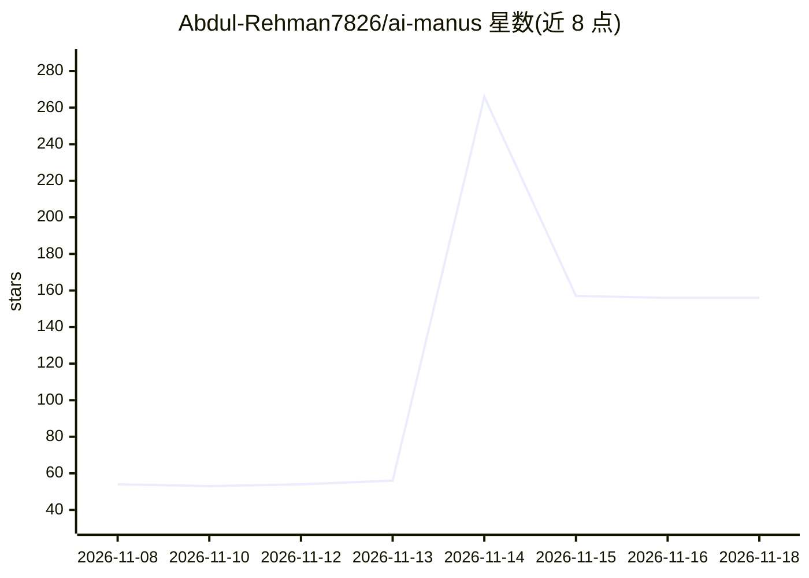

# Abdul-Rehman7826/ai-manus

⭐ 156 · Python · Apache-2.0 · 推送 2026-11-08 · [GitHub](https://github.com/Abdul-Rehman7826/ai-manus) · 个人维护

**面向日常小任务的自主 AI 代理：自动执行代码与控制浏览器**

README 描述的自主 AI 代理，供普通用户在家庭、学习与轻量工作场景使用：代理可自行编写并执行脚本、打开网页并与其元素交互、执行多步任务并跨会话保持模式。内容为宣传式说明，未给出具体技术栈、模型接入方式、安装命令或代码入口，仅列出硬件兼容表（最低 4 GB 内存、双核 CPU）与使用步骤描述。描述称其支持在沙箱环境中运行多种工具与操作。

## 筛选速览

| 维度 | 判定 | 备注 |
|---|---|---|
| AI 角色 | `ai-native` | 本体是模型或模型工具 |
| 许可风险 | `permissive` | Apache-2.0 |
| 部署形态 | `None` |  |
| 模型依赖 | — | README 未给出锁定关系 |
| 硬件要求 | — | 无带数字的原话,不猜 |
| 安装摩擦 | `low` | 无编译、无系统依赖或容器化 |
| 成熟度 | — | 结构信号不足 |

## 能力要点

- 自主执行代码与浏览器控制（导航网页、填写表单、抓取信息）
- 多步任务执行，脚本与浏览器动作可在同一流程中衔接
- 面向非开发者，无编程门槛即可使用

## 适用场景

- 让学生整理研究资料、跑小脚本和笔记
- 让代理代为完成重复性网页操作与信息收集
- 轻量办公中跨多标签页汇总信息、生成小报告

## 场景标签

`浏览器自动化` · 领域:效率与自动化

## 证据(README 行号)

> L10: - **Autonomous Code Execution:** Manus AI agent runs code on its own to complete tasks, so you can focus on decisio
> L18: Manus is an autonomous AI agent designed to run code and control a browser on your behalf. Instead of acting like a

## 星数曲线

2026-11-08 54 → 2026-11-18 156（+102）

---
*卡片 v1 · prompt 1.4 · 生成 2026-11-17 · 置信度 low · 依据 README sha `790070d90930` · [字段定义](../../DATASET.md)*
