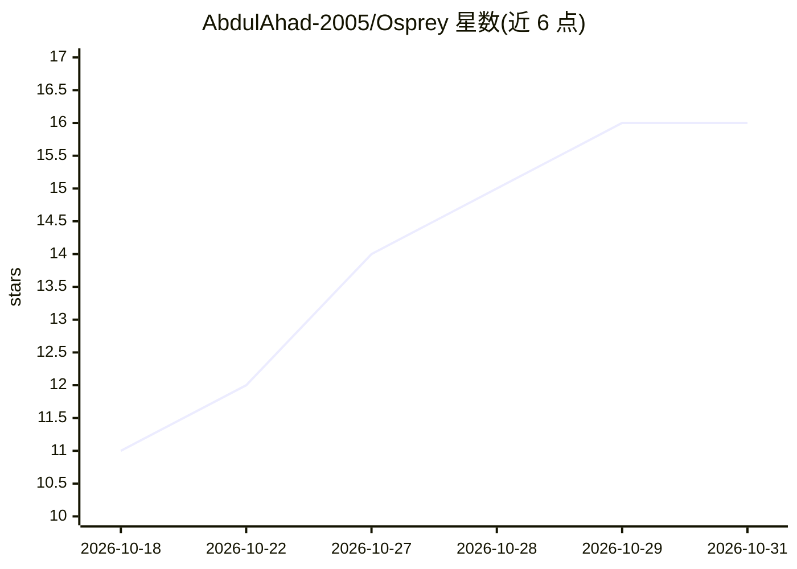

# AbdulAhad-2005/Osprey

⭐ 16 · Python · NOASSERTION · 推送 2026-10-29 · [GitHub](https://github.com/AbdulAhad-2005/Osprey) · 个人维护

**带可选 LLM 层的 AI 渗透测试平台（侦察/漏洞/利用）**

面向授权渗透测试的编排平台：以确定性侦察/漏洞循环为基线，提供可选 LLM 判断层（经 LiteLLM 接入任意模型）。组件含 FastAPI 后端、ReAct agent 循环、交互式 CLI、Next.js Operator Console 与 MCP 网关（可被 Claude、Cursor 等 MCP 客户端驱动）。工具通过 docker exec 到 Kali 工具容器或宿主 PATH 执行；支持全 Docker、精简 Docker、纯本地（SQLite）三种路径。仅限授权目标使用，AGPL v3。

## 筛选速览

| 维度 | 判定 | 备注 |
|---|---|---|
| AI 角色 | `ai-enhanced` | 去掉 AI 部分产品仍成立 |
| 许可风险 | `none` | NOASSERTION |
| 部署形态 | `desktop` | 安装包/桌面程序 |
| 模型依赖 | local-ok | 支持本地模型 |
| 硬件要求 | — | 无带数字的原话,不猜 |
| 安装摩擦 | `low` | 无编译、无系统依赖或容器化 |
| 成熟度 | — | 结构信号不足 |

## 能力要点

- 确定性 recon/vuln 循环为基线，LLM 层可选（engine 模式可无 LLM 运行）
- MCP 网关使任意 MCP 客户端可直接驱动平台
- 三种部署路径：全 Docker（90+ 工具 Kali 镜像）/精简 Docker/纯本地
- CLI 命令集与 Next.js Operator Console（攻击面图、报告导出）

## 适用场景

- 在授权目标上做侦察、漏洞分拣与利用编排
- 通过 Claude/Cursor 等 MCP 客户端驱动渗透流程
- 以无 LLM 的 engine 模式跑纯扫描器流程

## 场景标签

`网络安全` · 领域:学习与行业

## 证据(README 行号)

> L6: Deterministic recon/vuln loop as the baseline, an optional LLM layer for judgment —
> L224: > **Engine mode (`/scan <target> --engine`)** runs scanners with no LLM, so the
> L246: sense → decide → execute → evaluate → replan lifecycle with or without a

## 星数曲线

2026-10-18 11 → 2026-10-31 16（+5）

---
*卡片 v1 · prompt 1.4 · 生成 2026-10-30 · 置信度 high · 依据 README sha `fe22189bae7f` · [字段定义](../../DATASET.md)*
