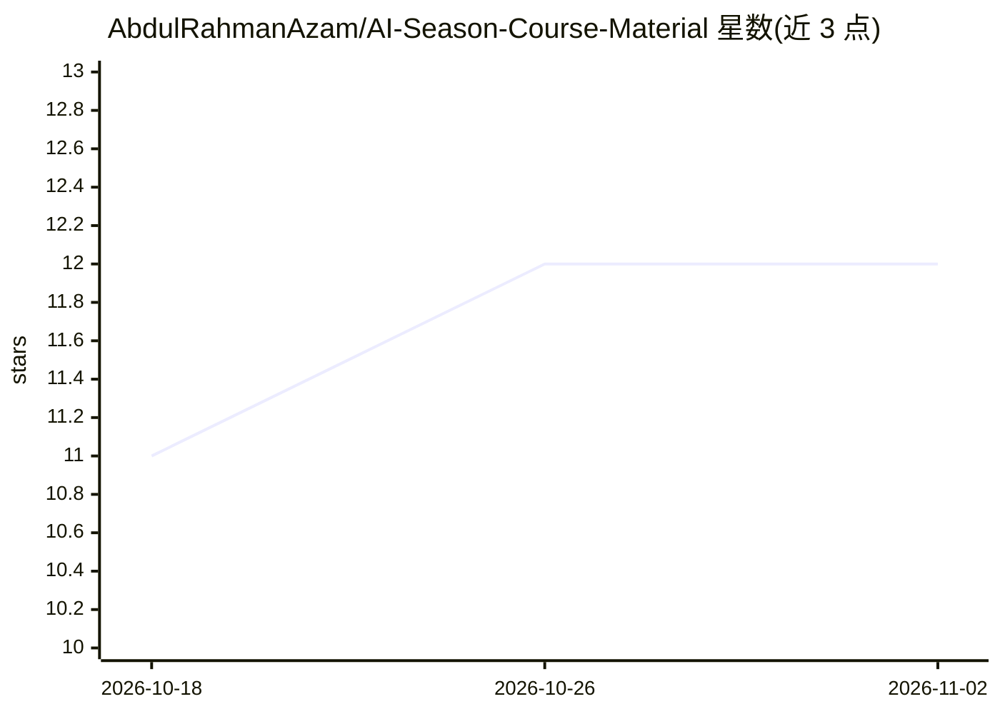

# AbdulRahmanAzam/AI-Season-Course-Material

⭐ 12 · Python · 推送 2026-09-25 · [GitHub](https://github.com/AbdulRahmanAzam/AI-Season-Course-Material) · [官网](https://aiseason.tech/free-ai-agents-course) · 个人维护

**AI agents 训练营配套的可运行课程代码（乌尔都语+英语授课）**

AI Season Cohort 01 训练营的教学代码仓库：每个目录为独立课时，含按序运行的编号脚本、说明 README 与 requirements.txt。内容覆盖 LLM API 调用、RAG、手写 agent 循环、LangChain、多模态 agent、A2A 协议，以及用 PyTorch 从零构建并部署一个小型语言模型（ARGPT）。代码为教学风格写成扁平脚本，多个模块在无 API key 时回退 mock 模式；通过 git clone 加虚拟环境运行。授课为乌尔都语讲解、英文代码，面向有基础 Python 的学员。

## 筛选速览

| 维度 | 判定 | 备注 |
|---|---|---|
| AI 角色 | `ai-knowledge` | 知识聚合/清单类 |
| 许可风险 | `none` | — |
| 部署形态 | `library` | 以包/库形式分发 |
| 模型依赖 | — | README 未给出锁定关系 |
| 硬件要求 | — | 无带数字的原话,不猜 |
| 安装摩擦 | `low` | 无编译、无系统依赖或容器化 |
| 成熟度 | — | 结构信号不足 |

## 能力要点

- 每课时自包含：编号脚本+说明 README+requirements.txt
- 从零构建语言模型（ARGPT，约 700 行，含 tokenizer/训练/部署）
- 无 API key 时多模块回退 mock 模式可离线跟学
- 手写 agent 循环（工具/记忆/安全规则/验证器）逐检查点构建

## 适用场景

- 系统自学 AI agent 开发：从 LLM API 到 A2A 多智能体
- 想了解语言模型内部原理的开发者照代码复现一个小型 LLM
- 参加训练营学员获取配套可运行代码

## 场景标签

`教程课程` · 领域:学习与行业

## 证据(README 行号)

> L7: Every folder is a self-contained lesson: numbered scripts you run in order, a README that explains
> L17: |Module|What you learn|Key tools|

## 星数曲线

2026-10-18 11 → 2026-11-02 12（+1）

---
*卡片 v1 · prompt 1.4 · 生成 2026-11-01 · 置信度 mid · 依据 README sha `9751adf532b4` · [字段定义](../../DATASET.md)*
