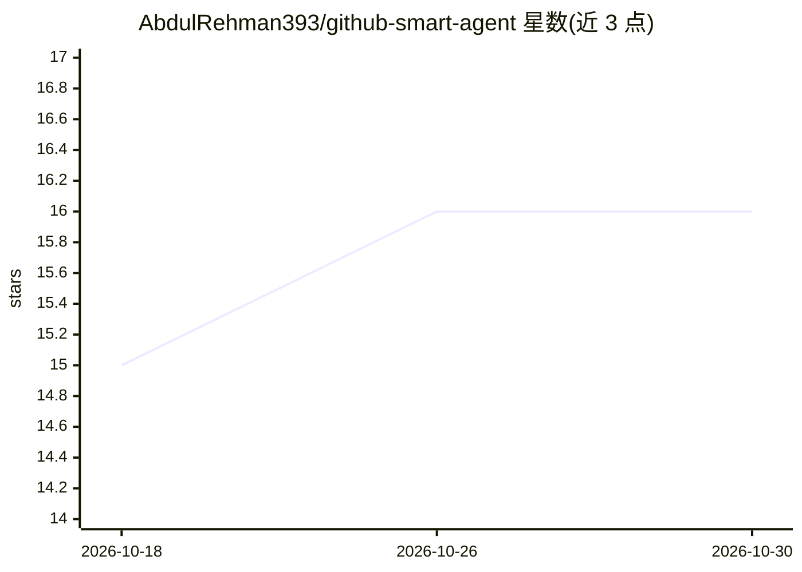

# AbdulRehman393/github-smart-agent

⭐ 16 · Python · MIT · 推送 2026-09-25 · [GitHub](https://github.com/AbdulRehman393/github-smart-agent) · 个人维护

**面向开发者的 GitHub 仓库 RAG 分析与问答工具**

Python 编写的 AI 开发者工具：输入 GitHub 仓库地址后，解析并索引整个仓库结构，基于 RAG（LangChain + FAISS）建立向量检索，通过 OpenRouter 网关调用 LLM（如 Gemini Flash / DeepSeek），支持对整个代码库的自然语言问答、结合静态检查与 LLM 推理的缺陷检测、优化建议与结构化分析报告。前端使用 Streamlit 界面，需配置 OPENROUTER_API_KEY 后本地运行。多仓库工作区、PR 审查模式等在 Roadmap 中列为未完成。

## 筛选速览

| 维度 | 判定 | 备注 |
|---|---|---|
| AI 角色 | `ai-native` | 本体是模型或模型工具 |
| 许可风险 | `permissive` | MIT |
| 部署形态 | `library` | 以包/库形式分发 |
| 模型依赖 | locked-api |  |
| 硬件要求 | — | 无带数字的原话,不猜 |
| 安装摩擦 | `low` | 无编译、无系统依赖或容器化 |
| 成熟度 | — | 结构信号不足 |

## 能力要点

- 整仓摄取并索引，支持全代码库范围的自然语言问答
- 静态确定性检查与 LLM 推理结合的缺陷检测
- 经 OpenRouter 调用 Gemini Flash / DeepSeek 等模型
- 生成可分享的结构化分析报告

## 适用场景

- 快速理解陌生代码库的架构与模块关系
- 定位异步/数据库等层面的潜在缺陷热点
- 为新工程师入职生成代码库说明报告

## 场景标签

`RAG` `代码审查` · 领域:编码与开发

## 证据(README 行号)

> L14: **GitHub Smart Agent** is a production-ready AI developer tool that ingests a full GitHub repository and enables yo
> L23: - 💬 **Codebase-wide Chat**

## 星数曲线

2026-10-18 15 → 2026-10-30 16（+1）

---
*卡片 v1 · prompt 1.4 · 生成 2026-10-30 · 置信度 mid · 依据 README sha `3d38f2354749` · [字段定义](../../DATASET.md)*
