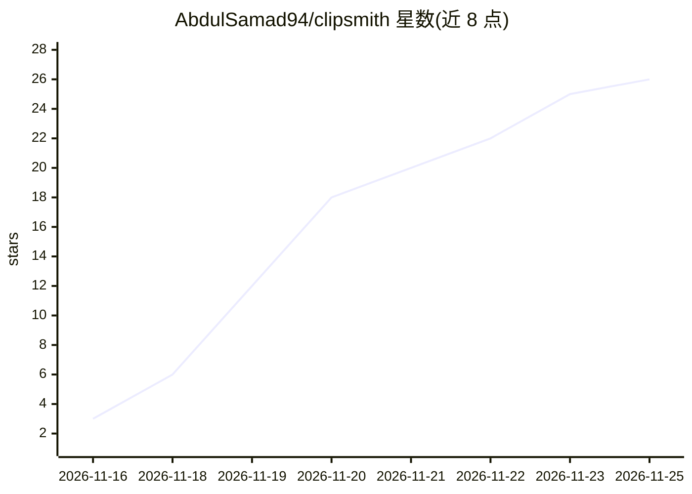

# AbdulSamad94/clipsmith

⭐ 26 · Python · MIT · 推送 2026-11-22 · [GitHub](https://github.com/AbdulSamad94/clipsmith) · 个人维护

**本地离线把长 YouTube 视频剪成带字幕竖屏 Shorts 的开源工具**

粘贴 YouTube 链接后，工具下载视频与字幕（无字幕时用 Whisper 转录），用本地模型挑选 30–60 秒片段并给出 viral score、标题与话题标签，按人脸裁切为 9:16，逐词烧录动效字幕，导出 MP4 或直接发布/定时到 YouTube。默认用 Ollama 拉取的本地 Qwen 模型，无需 API key 与 GPU，也可在 .env 中切换 Gemini/Claude 或规则打分。提供 Web 界面（127.0.0.1:8765）与安装/运行脚本。

## 筛选速览

| 维度 | 判定 | 备注 |
|---|---|---|
| AI 角色 | `ai-native` | 本体是模型或模型工具 |
| 许可风险 | `permissive` | MIT |
| 部署形态 | `None` |  |
| 模型依赖 | local-ok | 支持本地模型 |
| 硬件要求 | — | 无带数字的原话,不猜 |
| 安装摩擦 | `medium` | 含编译或系统依赖之一 |
| 成熟度 | — | 结构信号不足 |

## 能力要点

- 默认本地 Qwen 模型选片段，离线运行、无 API key、无水印
- 人脸跟踪 9:16 重构与逐词动效字幕（多种样式）
- 片段带 viral score、标题、hook 与推荐理由
- 可切换 Gemini/Claude 后端或纯规则打分，支持直发/定时 YouTube

## 适用场景

- 把长视频批量剪成可发布的竖屏 Shorts
- 本地离线处理视频、素材不出电脑
- 自动生成片段标题、描述与话题标签并发布到 YouTube

## 场景标签

`语音识别` `图像视频处理` · 领域:感知与多模态

## 证据(README 行号)

> L13: Paste a YouTube link. Clipsmith finds the best 30–60 second moments, crops them to vertical 9:16 around the speaker
> L16: - **Runs offline.** Moment picking uses a local AI model (Qwen via Ollama). No API key, no account, your videos nev
> L42: 1. **Downloads** the video and YouTube's captions (or transcribes the audio with Whisper if there are none).

## 星数曲线

2026-11-16 3 → 2026-11-25 26（+23）

---
*卡片 v1 · prompt 1.4 · 生成 2026-11-19 · 置信度 high · 依据 README sha `4cf6f2cbac5a` · [字段定义](../../DATASET.md)*
