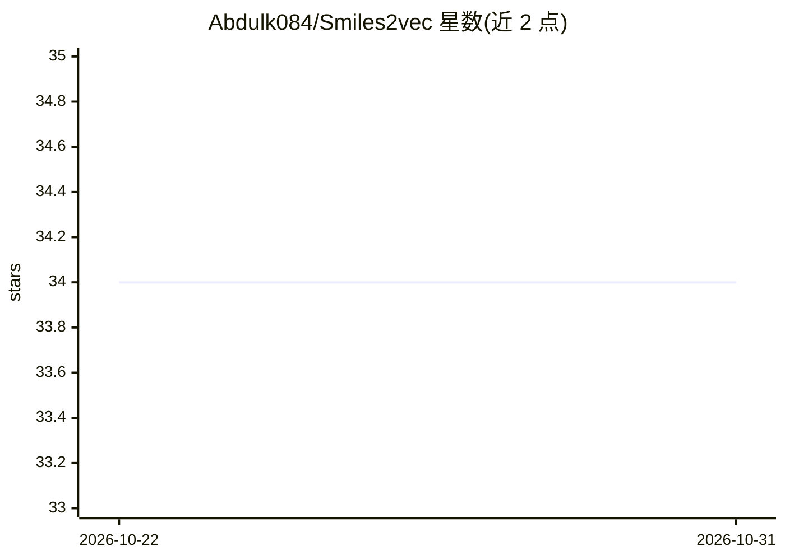

# Abdulk084/Smiles2vec

⭐ 34 · Jupyter Notebook · MIT · 推送 2026-10-20 · [GitHub](https://github.com/Abdulk084/Smiles2vec) · 个人维护

**smiles2vec 论文的概念验证实现：从 SMILES 预测毒性**

smiles2vec 论文（arXiv:1712.02034）的概念验证实现：直接从分子 SMILES 字符串预测活性，在 Tetrahymena pyriformis IGC50 48h 毒性数据集上训练，报告 R^2 值 0.69。以深度学习/神经网络方法实现，主题涉及制药领域。README 仅含简短描述，未给出安装或运行说明。

## 筛选速览

| 维度 | 判定 | 备注 |
|---|---|---|
| AI 角色 | `ai-native` | 本体是模型或模型工具 |
| 许可风险 | `permissive` | MIT |
| 部署形态 | `None` |  |
| 模型依赖 | — | README 未给出锁定关系 |
| 硬件要求 | — | 无带数字的原话,不猜 |
| 安装摩擦 | `low` | 无编译、无系统依赖或容器化 |
| 成熟度 | — | 结构信号不足 |

## 能力要点

- 从 SMILES 字符串直接预测活性
- 在 IGC50 48h 毒性数据集上取得 R^2 0.69
- 对应论文 arXiv:1712.02034

## 适用场景

- 复现 smiles2vec 论文在 IGC50 数据集上的结果
- 参考 SMILES 到活性预测的深度学习实现方式

## 场景标签

 · 领域:药物/化学信息学

## 证据(README 行号)

> L2: Proof of the concept implementation of smiles2vec paper
> L4: Implementation of SMILES2VEC paper for IGC50 data set.
> L9: Activity is predicted from the smiles directly and R^2 value of 0.69 is obtained. The data set is about

## 星数曲线

2026-10-22 34 → 2026-10-31 34（+0）

---
*卡片 v1 · prompt 1.4 · 生成 2026-10-25 · 置信度 mid · 依据 README sha `312967a9f781` · [字段定义](../../DATASET.md)*
