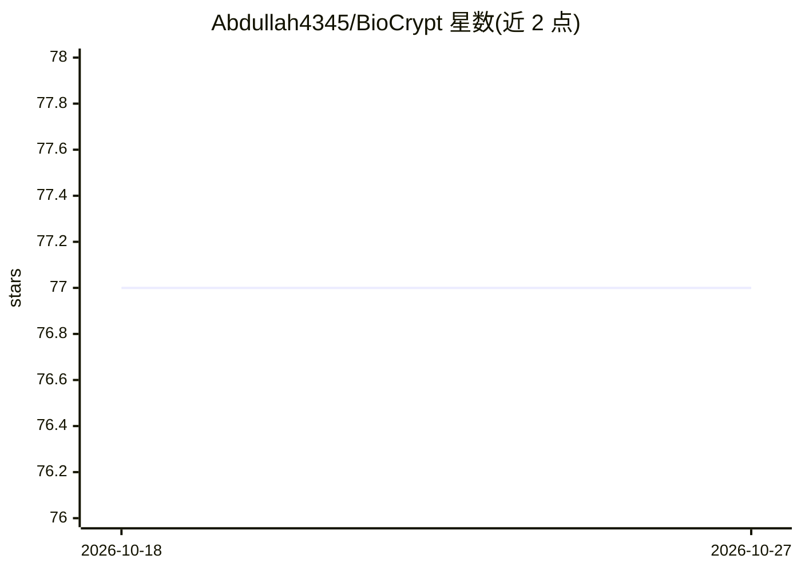

# Abdullah4345/BioCrypt

⭐ 77 · Python · MIT · 推送 2025-11-12 · [GitHub](https://github.com/Abdullah4345/BioCrypt) · [官网](https://youtu.be/QyMXk6T6Zio) · 组织维护

**指纹认证驱动的文件加密系统，含本地/云/IPFS 区块链存储**

基于指纹认证与 AES-256 的文件加密系统：由指纹哈希生成密钥对文件加解密，含反欺骗机制。提供四种存储/传输方式：本地加密库 The Vault（OTP 取件）、Google Drive 云存储（OTP 认证）、IPFS 分片 + Ethereum 区块链记录 CID 的 ChainSpace、P2P 式 SafeMail 邮件加密传输，另有蓝牙离线传输与时间锁自动删除。AI 为可选功能：使用 Gemini-1.5 Pro 做加密前的多模态文件摘要和应用内帮助聊天机器人。README 未给出安装或运行命令。

## 筛选速览

| 维度 | 判定 | 备注 |
|---|---|---|
| AI 角色 | `ai-enhanced` | 去掉 AI 部分产品仍成立 |
| 许可风险 | `permissive` | MIT |
| 部署形态 | `None` |  |
| 模型依赖 | — | README 未给出锁定关系 |
| 硬件要求 | — | 无带数字的原话,不猜 |
| 安装摩擦 | `low` | 无编译、无系统依赖或容器化 |
| 成熟度 | — | 结构信号不足 |

## 能力要点

- 指纹哈希派生密钥的 AES-256 加密，含反欺骗机制
- IPFS 分片存储 + Ethereum 区块链记录 CID
- OTP 认证的本地 Vault 与 Google Drive 云存储
- Gemini-1.5 Pro 文件摘要与应用内 Help Bot

## 适用场景

- 用指纹认证加密并本地存储敏感文件
- 通过 IPFS 与区块链存证实现防篡改文件备份
- 经邮件或蓝牙安全传输加密文件

## 场景标签

 · 领域:安全/文件加密

## 证据(README 行号)

> L4:  BioCrypt is an advanced biometric-based encryption system designed to secure sensitive files using fingerprint auth
> L45:  Summaries: an AI program that uses Gemni-1.5 pro to capture a quick overview of the files before encrypting and
> L52:  Assistant: an AI chatbot that uses the same model as summaries (Gemni-1.5 pro) to assist the user in navigating th

## 星数曲线

2026-10-18 77 → 2026-10-27 77（+0）

---
*卡片 v1 · prompt 1.4 · 生成 2026-10-24 · 置信度 high · 依据 README sha `2c8d663a54bd` · [字段定义](../../DATASET.md)*
