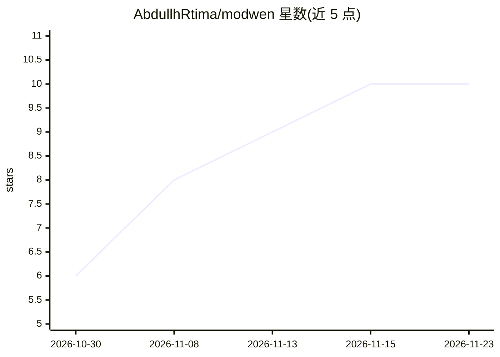

# AbdullhRtima/modwen

⭐ 10 · Python · Apache-2.0 · 推送 2026-11-12 · [GitHub](https://github.com/AbdullhRtima/modwen) · [官网](https://modwen.rtima.org/) · 个人维护

**面向阿拉伯语优先的本地离线会议转写笔记应用**

Modwen（مُدوَّن）是一款在 Mac 和 Windows 本地运行的会议笔记应用：通过 Whisper 转写阿拉伯语、英语及混合语语音（支持海湾、黎凡特、埃及方言），再用本地 LLM（Qwen）生成摘要、决议、带负责人和期限的行动项。音频与转录不离开本机，非 localhost 端点在代码中被拒绝，录音按会议单独加密。当前状态为 alpha 0.2，已在 macOS（Apple Silicon）验证，Windows 支持代码已写但未测试。

## 筛选速览

| 维度 | 判定 | 备注 |
|---|---|---|
| AI 角色 | `ai-native` | 本体是模型或模型工具 |
| 许可风险 | `permissive` | Apache-2.0 |
| 部署形态 | `library` | 以包/库形式分发 |
| 模型依赖 | local-ok | 支持本地模型 |
| 硬件要求 | — | 无带数字的原话,不猜 |
| 安装摩擦 | `medium` | 含编译或系统依赖之一 |
| 成熟度 | `idea` | |

## 能力要点

- Whisper 转写阿/英/混合语音与方言，提供实时字幕
- 本地 Qwen LLM 生成摘要、决议与行动项
- 隐私机制：非 localhost 端点拒绝、录音按会议加密
- 支持接入 Ollama/LM Studio/llama.cpp/vLLM 等本地服务器

## 适用场景

- Google Meet、Teams 或线下会议的实时字幕与纪要生成
- 阿拉伯语环境下离线生成会议摘要与行动项
- 隐私要求下音频不出本机的本地转写

## 场景标签

`语音识别` · 领域:感知与多模态

## 证据(README 行号)

> L15: **Free, open-source meeting notes built for Arabic first.** Modwen transcribes Arabic and English meetings, even bo
> L22:  - Press Stop, and Whisper transcribes Arabic, English and mixed speech (code-switching, including Gulf, Levantine 
> L23:  - A local LLM (Qwen) writes the summary, decisions, action items with owners and deadlines, and open questions.

## 星数曲线

2026-10-30 6 → 2026-11-23 10（+4）

---
*卡片 v1 · prompt 1.4 · 生成 2026-11-20 · 置信度 high · 依据 README sha `b4bb06606aad` · [字段定义](../../DATASET.md)*
