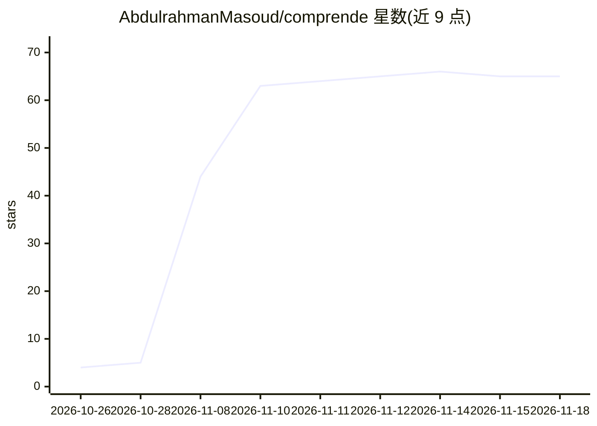

# AbdulrahmanMasoud/comprende

⭐ 65 · JavaScript · MIT · 推送 2026-11-17 · [GitHub](https://github.com/AbdulrahmanMasoud/comprende) · 个人维护 · 中文 README

**AI 编码代理插件：解释其写的代码并在推送前问答验证理解**

面向 Claude Code、Cursor、Codex 与 Antigravity 的插件，含两个功能：一是让代理用用户语言简要解释其新写代码中的新 API、非显然逻辑与风险；二是可选的按仓库启用的所有权门禁——推送/合并前代理就改动提问 1-6 个问题，开发者亲自撰写 PR 摘要，报告存入 .learning/checks/ 并随代码提交，未通过时 agent 推送、git hook 与 CI 均会拦截。回答与进度记录保存在本地 ~/.comprende/。需要 Node.js 20+；Windows 下为实验性，Antigravity 的 IDE/App 未经测试。

## 筛选速览

| 维度 | 判定 | 备注 |
|---|---|---|
| AI 角色 | `ai-ecosystem` | LLM/agent 周边工具 |
| 许可风险 | `permissive` | MIT |
| 部署形态 | `None` |  |
| 模型依赖 | locked-api |  |
| 硬件要求 | — | 无带数字的原话,不猜 |
| 安装摩擦 | `low` | 无编译、无系统依赖或容器化 |
| 成熟度 | `idea` | |

## 能力要点

- 代理解释新代码的 API、逻辑与风险，可用任意语言引导
- 推送前所有权检查：问答 + 开发者自写 PR 摘要，报告随代码提交
- 四层拦截：agent 拒推、git hook、CI 检查、pre-tool hook
- 支持 Claude Code / Cursor / Codex / Antigravity 四种工具安装

## 适用场景

- 团队要求开发者在合并 AI 生成代码前证明理解
- 让 AI 代理持续解释它写的非显然逻辑与风险
- 在 PR 上查看开发者自述摘要与各文件涉及概念

## 场景标签

`代码审查` · 领域:编码与开发

## 证据(README 行号)

> L7: Comprende is a plugin for Claude Code, Cursor, Codex and Antigravity. It does two things:
> L10: 2. **The ownership check** (optional, per repo). Before your code is pushed, the agent asks you a few questions abo

## 星数曲线

2026-10-26 4 → 2026-11-18 65（+61）

---
*卡片 v1 · prompt 1.4 · 生成 2026-11-18 · 置信度 high · 依据 README sha `b0ab82db32df` · [字段定义](../../DATASET.md)*
