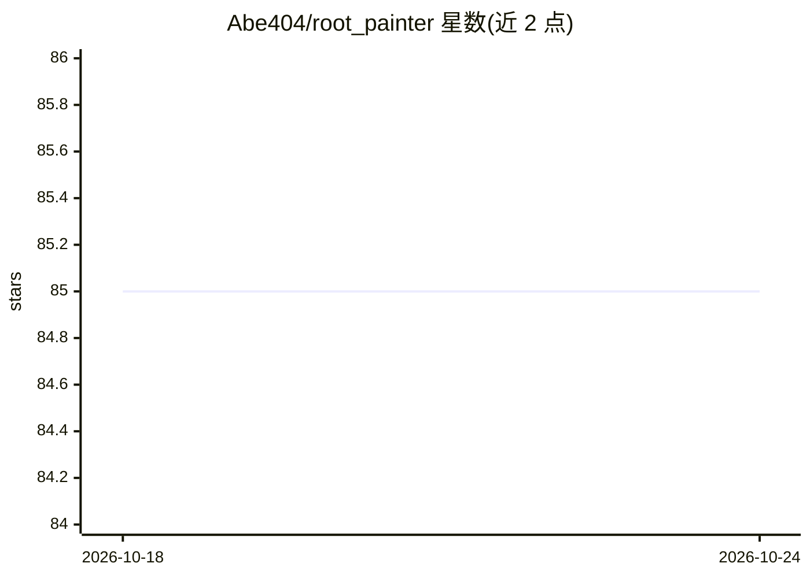

# Abe404/root_painter

⭐ 85 · Python · NOASSERTION · 推送 2026-10-10 · [GitHub](https://github.com/Abe404/root_painter) · [官网](https://nph.onlinelibrary.wiley.com/doi/full/10.1111/nph.18387) · 个人维护

**生物图像深度学习分割 GUI 软件：人机回环纠错标注训练**

RootPainter 是用于生物图像分析的 GUI 软件，通过人机回环（human-in-the-loop）纠错标注方式快速训练深度神经网络进行图像分割。采用客户端-服务器架构：普通笔记本作为客户端运行界面，训练在配备 GPU 的服务器（或 Google Colab）上进行，客户端与服务器通过同步目录共享数据。客户端可从 releases 下载，服务器端通过 pip 安装 trainer 并以 start-trainer 命令启动。提供 Colab 教程、视频与 mini guide 等入门材料。

## 筛选速览

| 维度 | 判定 | 备注 |
|---|---|---|
| AI 角色 | `ai-native` | 本体是模型或模型工具 |
| 许可风险 | `none` | NOASSERTION |
| 部署形态 | `library` | 以包/库形式分发 |
| 模型依赖 | — | README 未给出锁定关系 |
| 硬件要求 | — | 无带数字的原话,不猜 |
| 安装摩擦 | `medium` | 含编译或系统依赖之一 |
| 成熟度 | — | 结构信号不足 |

## 能力要点

- 客户端-服务器架构，笔记本客户端利用远程 GPU 训练
- 人机回环纠错标注式的交互式分割训练
- 支持 NVIDIA CUDA GPU 或 Apple Silicon (MPS)
- 提供 Colab 教程、安装与使用视频

## 适用场景

- 生物图像（如根系）的交互式深度学习分割与测量
- 没有本地 GPU 时通过 Google Colab 训练分割模型
- 用纠错标注迭代改进模型精度

## 场景标签

`目标检测` · 领域:感知与多模态

## 证据(README 行号)

> L3: RootPainter is a GUI-based software tool for the rapid training of deep neural networks for use in image analysis.
> L6: A detailed description is available in the paper published in the New Phytologist RootPainter: Deep Learning Segment

## 星数曲线

2026-10-18 85 → 2026-10-24 85（+0）

---
*卡片 v1 · prompt 1.4 · 生成 2026-10-24 · 置信度 high · 依据 README sha `2050d2141eb2` · [字段定义](../../DATASET.md)*
