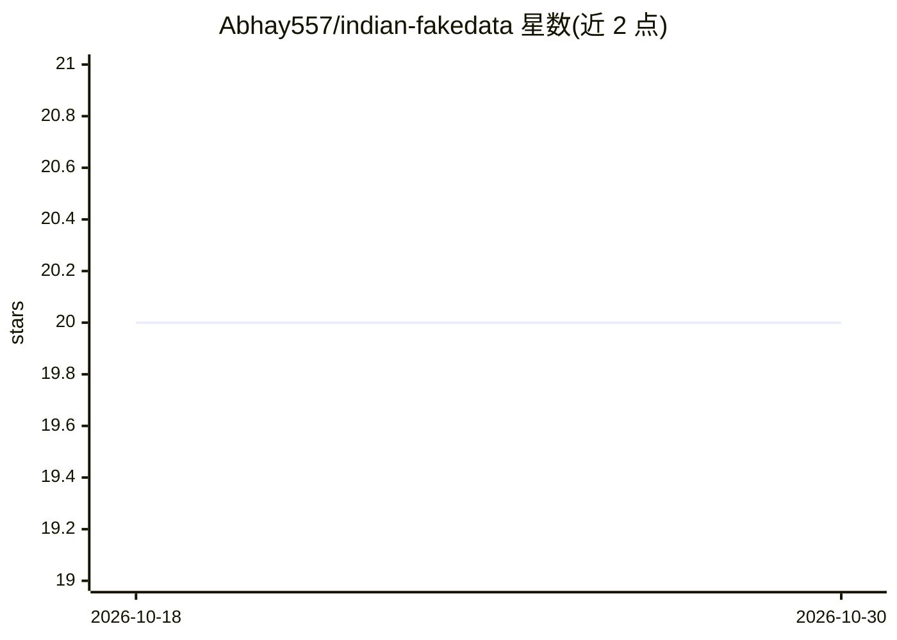

# Abhay557/indian-fakedata

⭐ 20 · TypeScript · MIT · 推送 2026-09-30 · [GitHub](https://github.com/Abhay557/indian-fakedata) · [官网](https://abhay557.github.io/indian-fakedata/) · 个人维护

**基于印度 2011 普查统计生成仿真印度人口画像的库**

提供 Node.js/TypeScript 与 Python 双实现的模拟数据生成库，按 Census 2011、NFHS-5、MSME Census 等公开统计校准变量间相关性，生成宗教、种姓、职业、外貌、就业时间线等字段一致的虚构印度人口画像，支持人口学约束过滤、结果模拟（含偏差参数）、叙事文本生成与 LLM agent persona。两语言均带 CLI，可输出 json/jsonl/csv，同版本内种子可复现。每个画像带 synthetic 溯源标记，并提供 JSON Schema 校验与 PII 剥离函数。

## 筛选速览

| 维度 | 判定 | 备注 |
|---|---|---|
| AI 角色 | `ai-ecosystem` | LLM/agent 周边工具 |
| 许可风险 | `permissive` | MIT |
| 部署形态 | `library` | 以包/库形式分发 |
| 模型依赖 | — | README 未给出锁定关系 |
| 硬件要求 | — | 无带数字的原话,不猜 |
| 安装摩擦 | `low` | 无编译、无系统依赖或容器化 |
| 成熟度 | — | 结构信号不足 |

## 能力要点

- 基于 Census 2011 等公开统计校准的变量关联生成
- CLI 与程序 API 双入口，支持人口学约束过滤与种子复现
- 增强层：结果模拟、叙事文档、LLM agent persona（英语/印地语/印地英语）
- 内置 JSON Schema 校验与 PII 剥离（stripPII/--strip-pii）

## 适用场景

- 为应用开发测试生成符合印度人口统计的模拟用户数据
- 构建带真实相关性的 LLM agent persona 测试集
- 教学或研究中模拟人口学分布与结果偏差实验

## 场景标签

 · 领域:数据生成/测试工具

## 证据(README 行号)

> L5: A library that generates culturally accurate, statistically consistent mock Indian demographic profiles backed by **
> L99: |`--persona`|**[Layer 4]** Generate LLM-ready agent persona (system prompt + full roleplay prompt, beliefs, memory 
> L8: 1. A **Node.js / TypeScript** package (`@abhay557/indian-fakedata`)

## 星数曲线

2026-10-18 20 → 2026-10-30 20（+0）

---
*卡片 v1 · prompt 1.4 · 生成 2026-10-28 · 置信度 high · 依据 README sha `2ded15c3f774` · [字段定义](../../DATASET.md)*
