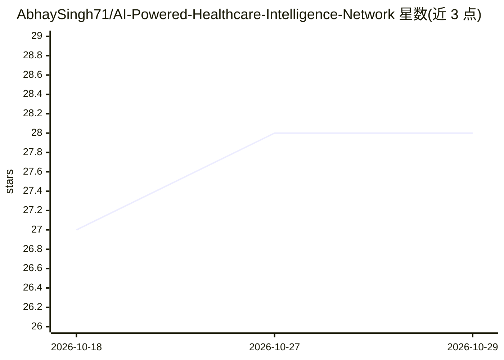

# AbhaySingh71/AI-Powered-Healthcare-Intelligence-Network

⭐ 28 · Jupyter Notebook · MIT · 推送 2026-06-10 · [GitHub](https://github.com/AbhaySingh71/AI-Powered-Healthcare-Intelligence-Network) · 个人维护

**面向患者与医生的医疗 AI 平台：疾病预测、用药推荐与问诊机器人**

基于 Streamlit 的医疗智能应用，包含四个模块：基于 RandomForest 的症状疾病预测与治疗建议；基于 NLP 余弦相似度的替代药品推荐；基于 LightGBM/EasyEnsemble 的心脏病风险评估；以及 Medibot 聊天助手，使用 Hugging Face 托管的 Mistral-7B-Instruct 模型，从 FAISS 向量库检索资料并以 RAG 方式回答医疗问题。安装支持 git clone 源码运行（需 HF_TOKEN）与 Docker 镜像两种途径。

## 筛选速览

| 维度 | 判定 | 备注 |
|---|---|---|
| AI 角色 | `ai-native` | 本体是模型或模型工具 |
| 许可风险 | `permissive` | MIT |
| 部署形态 | `self-host` | docker 或自建部署 |
| 模型依赖 | — | README 未给出锁定关系 |
| 硬件要求 | — | 无带数字的原话,不猜 |
| 安装摩擦 | `low` | 无编译、无系统依赖或容器化 |
| 成熟度 | — | 结构信号不足 |

## 能力要点

- RandomForest 症状→疾病预测，输出治疗、用药与饮食建议
- NLP 余弦相似度匹配同成分替代药品
- LightGBM/EasyEnsemble 心脏病风险评分
- Medibot 聊天助手：Mistral-7B-Instruct + FAISS 向量库 RAG 问答

## 适用场景

- 输入症状获取疾病预测与就医建议
- 查询与某药品成分相似的替代药
- 评估个人心脏病风险并获得建议
- 通过聊天机器人查询医疗健康知识

## 场景标签

`聊天机器人` `推荐系统` · 领域:对话与助手

## 证据(README 行号)

> L61:  Our LLM-powered chatbot answers medical queries and provides instant healthcare insights using Hugging Face LLM (M
> L25:  This module uses Machine Learning to predict diseases based on symptoms and suggest the best medical recommendatio
> L49:  This module uses LightGBM & AI classifiers to assess heart disease risks based on patient history.

## 星数曲线

2026-10-18 27 → 2026-10-29 28（+1）

---
*卡片 v1 · prompt 1.4 · 生成 2026-10-27 · 置信度 high · 依据 README sha `128ed48d50de` · [字段定义](../../DATASET.md)*
