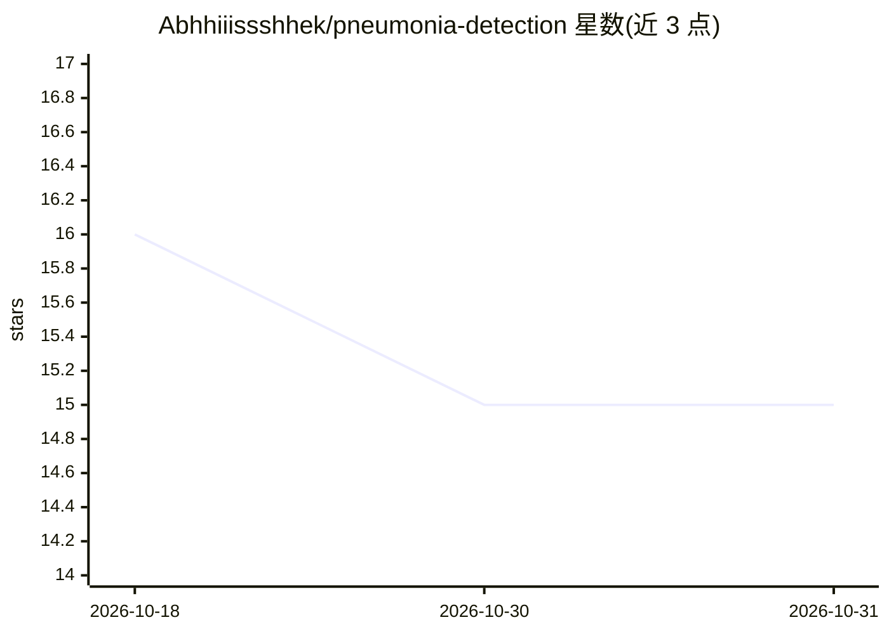

# Abhhiiissshhek/pneumonia-detection

⭐ 15 · Python · 推送 2026-09-07 · [GitHub](https://github.com/Abhhiiissshhek/pneumonia-detection) · 个人维护

**用 ResNet18 从胸片 X 光图像分类是否患肺炎的深度学习应用**

端到端深度学习项目：基于 PyTorch 对 ImageNet 预训练的 ResNet18 做迁移学习，微调最后的分类层，将胸片 X 光图像二分类为 Normal 或 Pneumonia，报告准确率约 95%、Pneumonia 召回约 96%。训练与评估以独立 Python 脚本执行，推理通过 Streamlit 网页上传图像实时完成。数据集使用 Kaggle 的 Chest X-ray Pneumonia Dataset，需自行下载；训练好的 .pth 权重文件未包含在仓库中，需用户自行训练复现。

## 筛选速览

| 维度 | 判定 | 备注 |
|---|---|---|
| AI 角色 | `ai-native` | 本体是模型或模型工具 |
| 许可风险 | `none` | — |
| 部署形态 | `library` | 以包/库形式分发 |
| 模型依赖 | — | README 未给出锁定关系 |
| 硬件要求 | — | 无带数字的原话,不猜 |
| 安装摩擦 | `low` | 无编译、无系统依赖或容器化 |
| 成熟度 | — | 结构信号不足 |

## 能力要点

- ResNet18 迁移学习微调分类层，PyTorch 实现
- Streamlit 网页界面上传 X 光图像实时推理
- 独立训练与评估脚本（准确率、召回、混淆矩阵）

## 适用场景

- 上传胸片 X 光图像获得 Normal/Pneumonia 分类结果
- 学习迁移学习与医学图像分类的完整流程
- 复现并评估肺炎检测模型的训练实验

## 场景标签

`目标检测` · 领域:感知与多模态

## 证据(README 行号)

> L3: An end-to-end deep learning application for detecting **Pneumonia** from chest X-ray images using a fine-tuned **Res
> L7: Pneumonia is a potentially life-threatening lung infection where early diagnosis is critical. This project leverages

## 星数曲线

2026-10-18 16 → 2026-10-31 15（-1）

---
*卡片 v1 · prompt 1.4 · 生成 2026-10-31 · 置信度 mid · 依据 README sha `22b6090bc073` · [字段定义](../../DATASET.md)*
