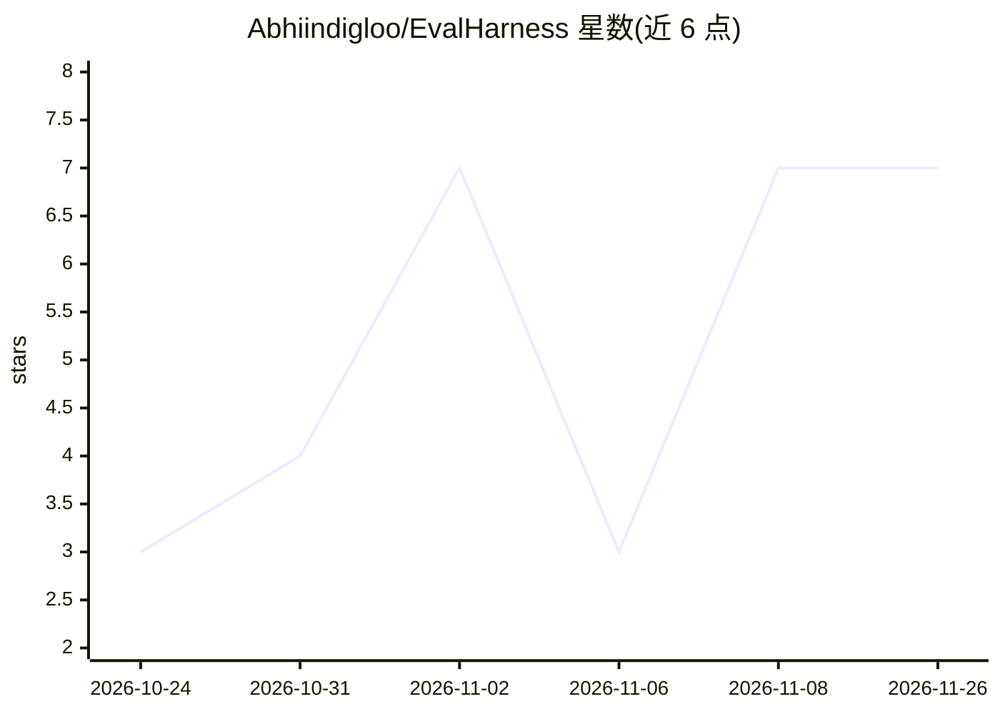

# Abhiindigloo/EvalHarness

⭐ 7 · Python · MIT · 推送 2026-11-21 · [GitHub](https://github.com/Abhiindigloo/EvalHarness) · [官网](https://indigloo.co) · 组织维护

**帮开发者找出通过自家测试的最便宜 AI 模型的评测与路由工具**

由四个 Agent Skills 和一个本地 MCP 服务器组成（Python 3.9+ 标准库，零依赖）：审计仓库中使用的模型与 SDK、从提示词草拟评测样例（默认丢弃个人数据与密钥）、用用户自己的 key 跑评测并统计通过率/延迟/成本、按成本排序生成 cheapest-first 路由配置（含 LiteLLM config），并估算本地模型权重与 KV cache 内存。服务器仅本地 stdio 运行，无网络调用、不写文件；付费调用仅发生在用户运行评测脚本与生成的路由器时。以 MIT 许可发布，提供 PyPI 包与多客户端插件安装方式。

## 筛选速览

| 维度 | 判定 | 备注 |
|---|---|---|
| AI 角色 | `ai-ecosystem` | LLM/agent 周边工具 |
| 许可风险 | `permissive` | MIT |
| 部署形态 | `desktop` | 安装包/桌面程序 |
| 模型依赖 | — | README 未给出锁定关系 |
| 硬件要求 | — | 无带数字的原话,不猜 |
| 安装摩擦 | `low` | 无编译、无系统依赖或容器化 |
| 成熟度 | — | 结构信号不足 |

## 能力要点

- 四个 Agent Skills：find-model / eval-models / route-models / size-local-model
- 十个只读 MCP 工具，覆盖审计、评测草拟、成本排序、路由生成与内存估算
- 本地 stdio MCP 服务器零依赖，无网络调用、不读 API key、不写文件
- 生成 standalone router 与 LiteLLM 配置的 cheapest-first 路由

## 适用场景

- 在仓库中审计使用了哪些模型 ID 与 SDK，并按 file:line 定位硬编码
- 用自有测试题评测候选模型，按每个通过答案的成本排序选型
- 搭建带质量守卫的最便宜优先路由配置
- 评估本地硬件能否运行指定规模的模型

## 场景标签

`模型评测` `模型网关` · 领域:Agent 开发

## 证据(README 行号)

> L24: > **Runs locally.** Model Finder is a set of four Agent Skills plus a local MCP server (`mcp/server.py`, Python 3.9
> L37: |`find-model`|Recommends models across Claude, Gemini, OpenAI, cloud, and local options for your task, budget, and 
> L39: |`route-models`|Builds a cheapest-first routing setup: a standalone router with quality guards plus a LiteLLM confi

## 星数曲线

2026-10-24 3 → 2026-11-26 7（+4）

---
*卡片 v1 · prompt 1.4 · 生成 2026-11-20 · 置信度 high · 依据 README sha `64f10acb0a52` · [字段定义](../../DATASET.md)*
