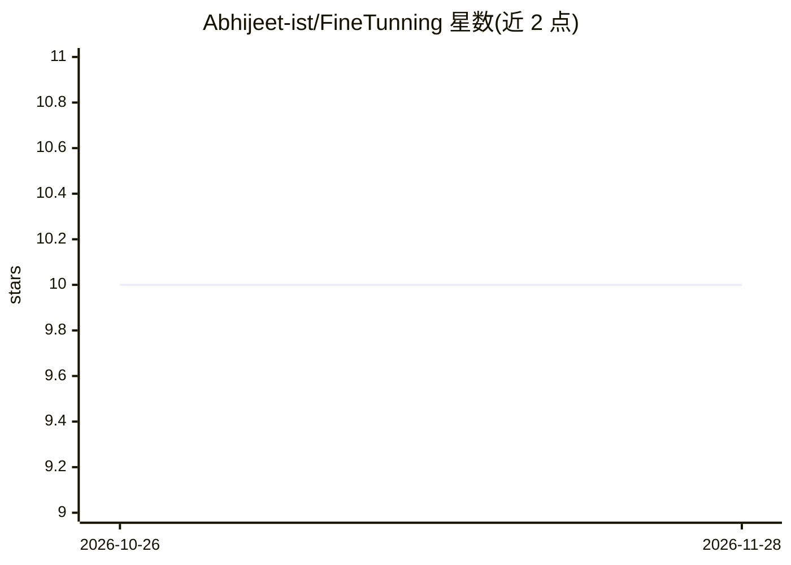

# Abhijeet-ist/FineTunning

⭐ 10 · Jupyter Notebook · 推送 2026-02-24 · [GitHub](https://github.com/Abhijeet-ist/FineTunning) · 个人维护

**在 Kaggle 免费 GPU 上用 LoRA 微调开源 LLM 的教程笔记本**

单个 Jupyter 笔记本，演示在 Kaggle 免费 T4 GPU 上用 LoRA（PEFT）与 4-bit 量化（BitsAndBytes）微调语言模型的全过程：加载 JSON 格式 instruction-response 数据集、配置梯度累积与 FP16 混合精度等内存优化参数、训练约 30-40 分钟后仅保存轻量 LoRA 适配器。面向希望在免费算力环境学习微调流程的使用者；需自行准备数据集与 Hugging Face token，也可克隆到本地运行。

## 筛选速览

| 维度 | 判定 | 备注 |
|---|---|---|
| AI 角色 | `ai-knowledge` | 知识聚合/清单类 |
| 许可风险 | `none` | — |
| 部署形态 | `library` | 以包/库形式分发 |
| 模型依赖 | — | README 未给出锁定关系 |
| 硬件要求 | — | 无带数字的原话,不猜 |
| 安装摩擦 | `medium` | 含编译或系统依赖之一 |
| 成熟度 | — | 结构信号不足 |

## 能力要点

- LoRA + 4-bit 量化的参数高效微调流程（PEFT/BitsAndBytes）
- 针对 Kaggle 免费 T4 GPU 优化的训练参数（batch size 1、梯度累积 4、500 步上限）
- 仅保存 LoRA 适配器以减小存储
- JSON instruction-response 对的数据集格式约定

## 适用场景

- 没有本地 GPU，想在 Kaggle 免费额度里跑一次 LLM 微调
- 用自己的 instruction-response 数据定制开源模型
- 学习 LoRA 与 4-bit 量化的 notebook 实现步骤

## 场景标签

`教程课程` `微调` · 领域:学习与行业

## 证据(README 行号)

> L3: This repository contains a Jupyter notebook for fine-tuning language models using LoRA (Low-Rank Adaptation) and 4-b
> L17: ## Kaggle Usage

## 星数曲线

2026-10-26 10 → 2026-11-28 10（+0）

---
*卡片 v1 · prompt 1.4 · 生成 2026-11-20 · 置信度 high · 依据 README sha `a32257296bf4` · [字段定义](../../DATASET.md)*
