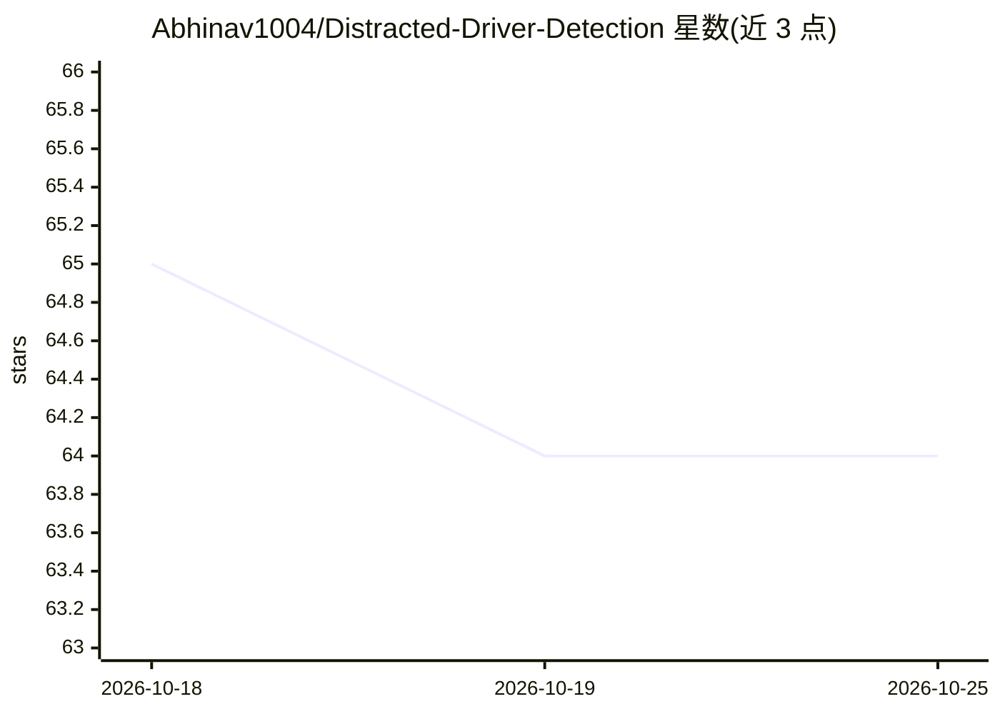

# Abhinav1004/Distracted-Driver-Detection

⭐ 64 · Jupyter Notebook · Apache-2.0 · 推送 2026-02-20 · [GitHub](https://github.com/Abhinav1004/Distracted-Driver-Detection) · 个人维护

**CNN 分类驾驶员行为图像，检测分心驾驶（Kaggle 竞赛项目）**

解决 Kaggle State Farm 分心驾驶员检测竞赛的个人项目：基于 2D 行车记录仪图像，构建 CNN 模型将驾驶员行为分为 10 类（安全驾驶、发短信、打电话、操作收音机、喝水等）。从零构建 4 层卷积 CNN，后改用 VGG16 迁移学习与微调（前 15 层冻结、SGD 优化器），图像预处理含 224x224 缩放与归一化。可应用于输入图像与视频，README 给出 Python 3.10 环境下的源码克隆与 pip 安装步骤。

## 筛选速览

| 维度 | 判定 | 备注 |
|---|---|---|
| AI 角色 | `ai-native` | 本体是模型或模型工具 |
| 许可风险 | `permissive` | Apache-2.0 |
| 部署形态 | `library` | 以包/库形式分发 |
| 模型依赖 | — | README 未给出锁定关系 |
| 硬件要求 | — | 无带数字的原话,不猜 |
| 安装摩擦 | `low` | 无编译、无系统依赖或容器化 |
| 成熟度 | — | 结构信号不足 |

## 能力要点

- 将驾驶员行为图像分类为 10 类（c0-c9）
- 从零 CNN 与 VGG16 迁移学习/微调四种方案对比
- 支持对输入图像与视频应用训练模型
- 提供模型方案解释与演示视频链接

## 适用场景

- 对行车记录仪图像自动识别分心驾驶行为
- 学习 CNN 与 VGG16 迁移学习的实现流程
- 复现 Kaggle 分心驾驶员检测竞赛方案

## 场景标签

`微调` · 领域:训练与推理

## 证据(README 行号)

> L19: In this project, I have created and refined machine learning models to detect
> L25: Given a dataset of 2D dashboard camera images, an algorithm needs to be
> L105: A standard CNN architecture was initially created and trained. We have created 4 convolutional layers with 4

## 星数曲线

2026-10-18 65 → 2026-10-25 64（-1）

---
*卡片 v1 · prompt 1.4 · 生成 2026-10-24 · 置信度 mid · 依据 README sha `58adc0bacca1` · [字段定义](../../DATASET.md)*
