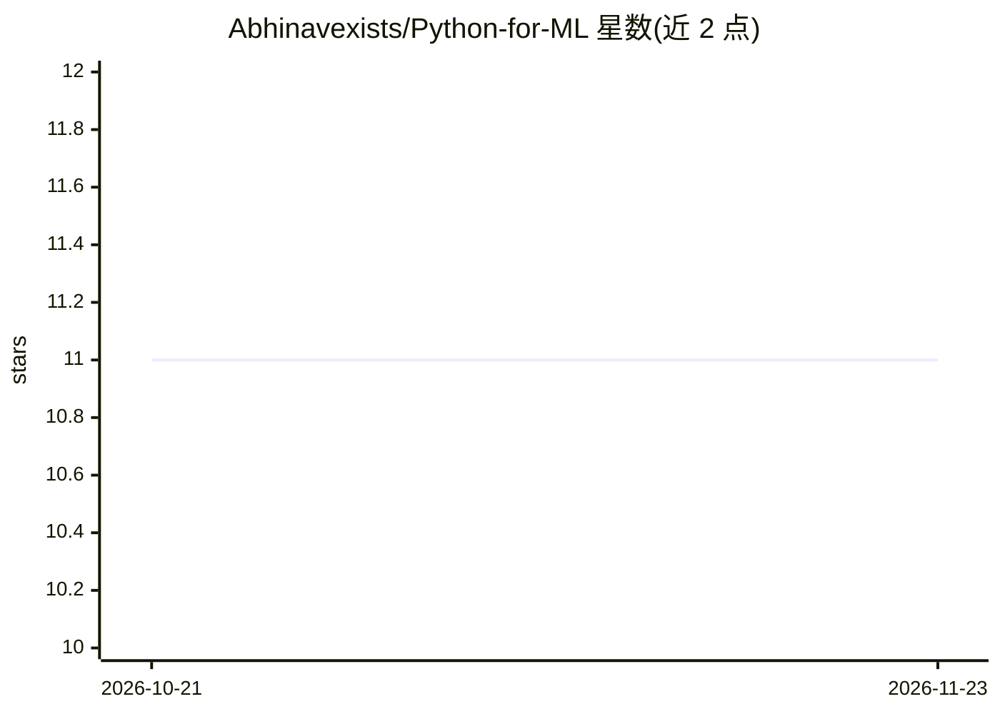

# Abhinavexists/Python-for-ML

⭐ 11 · Jupyter Notebook · MIT · 推送 2026-01-25 · [GitHub](https://github.com/Abhinavexists/Python-for-ML) · 个人维护

**面向 ML 方向学习者的 Python 结构化学习路径仓库**

从 Python 基础到机器学习技能的结构化学习路径，按 16 个模块组织课程：基础语法、控制流、数据结构、函数、模块；进阶的文件处理、异常处理、OOP、生成器；数据科学准备（NumPy/Pandas/Matplotlib/Seaborn、SQLite、日志、多线程、内存管理）；以及 Flask 和 Streamlit 的 Web 开发模块。以 Jupyter Notebook 呈现，提供 git clone 加虚拟环境的运行步骤，采用 MIT 许可并接受 PR。

## 筛选速览

| 维度 | 判定 | 备注 |
|---|---|---|
| AI 角色 | `ai-knowledge` | 知识聚合/清单类 |
| 许可风险 | `permissive` | MIT |
| 部署形态 | `library` | 以包/库形式分发 |
| 模型依赖 | — | README 未给出锁定关系 |
| 硬件要求 | — | 无带数字的原话,不猜 |
| 安装摩擦 | `low` | 无编译、无系统依赖或容器化 |
| 成熟度 | — | 结构信号不足 |

## 能力要点

- 16 个模块覆盖 Python 基础到数据科学/ML 准备
- 含 SQLite、多线程、内存管理等进阶主题
- 提供虚拟环境搭建与 Jupyter Notebook 运行步骤
- Streamlit 模块覆盖交互式数据应用与 ML 仪表盘

## 适用场景

- 零基础系统学习 Python 并过渡到数据科学
- 为机器学习应用补充 NumPy/Pandas 技能
- 按模块顺序查阅 Flask/Streamlit 数据应用开发

## 场景标签

`教程课程` · 领域:学习与行业

## 证据(README 行号)

> L11: This repository provides a **complete, hands-on learning path** for mastering Python programming with a focus on da
> L89: |**10**|Data Analysis|NumPy, Pandas, Matplotlib, Seaborn|

## 星数曲线

2026-10-21 11 → 2026-11-23 11（+0）

---
*卡片 v1 · prompt 1.4 · 生成 2026-11-19 · 置信度 high · 依据 README sha `79fd14a548f1` · [字段定义](../../DATASET.md)*
