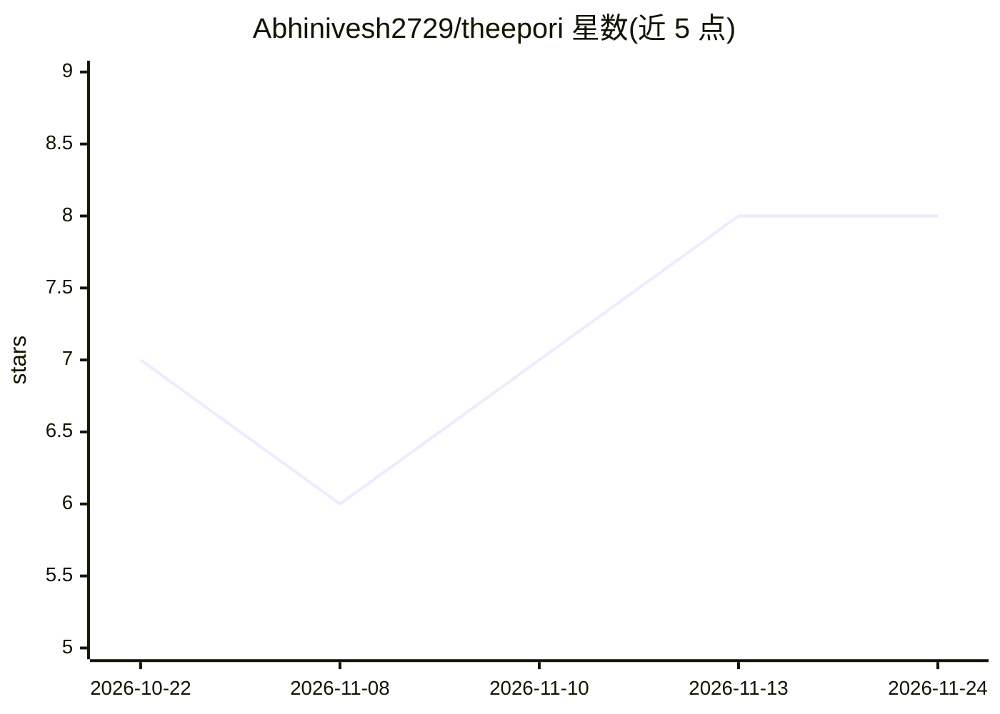

# Abhinivesh2729/theepori

⭐ 8 · Rust · MIT · 推送 2026-10-19 · [GitHub](https://github.com/Abhinivesh2729/theepori) · [官网](https://tp.0xabhi.space) · 个人维护

**面向单人的终端软件工厂守护进程，调度 Claude Code 执行任务**

以 Rust 实现的常驻守护进程（tpd）与配套 CLI（tp）及 macOS 应用：管理本地项目，将用户已安装的 Claude Code CLI 作为"员工"按任务在 git worktree 中启动，执行 实现→验证⇄修复→独立评审→PR→合并门→部署 的任务状态机；风险、合并、部署、预算等决策由确定性代码执行并留审计记录，内置沙箱、deny 规则与 fail-closed 策略钩子，agent 不执行 push、不接触密钥。支持从 GitHub issues 与 CI 失败流入任务，提供 Jira 同步、每日计划审批、暂停/安全模式/全部停止等控制。

## 筛选速览

| 维度 | 判定 | 备注 |
|---|---|---|
| AI 角色 | `ai-ecosystem` | LLM/agent 周边工具 |
| 许可风险 | `permissive` | MIT |
| 部署形态 | `None` |  |
| 模型依赖 | — | README 未给出锁定关系 |
| 硬件要求 | — | 无带数字的原话,不猜 |
| 安装摩擦 | `low` | 无编译、无系统依赖或容器化 |
| 成熟度 | `idea` | |

## 能力要点

- 守护进程 tpd 管理项目、任务状态机与每日计划
- 以已安装的 Claude Code CLI 作为执行者，在 git worktree 中按任务启动
- 沙箱、deny 规则、PreToolUse 策略钩子与 agent 无 push/无密钥约束
- 风险/合并/部署/预算/策略决策均为确定性代码并生成审计记录

## 适用场景

- 把 GitHub issues 与 CI 失败转成待审批任务并自动推进到 PR
- 在审批中心批准合并与部署并留存审计记录
- 为单人 founder 的一台 Mac 搭建个人软件流水线

## 场景标签

`编码 Agent` · 领域:编码与开发

## 证据(README 行号)

> L3: A personal software factory for one founder on one Mac. A persistent daemon (`tpd`) manages your projects. It runs y
> L24: - `tpd` is the factory. It runs intake (GitHub via `gh`), the daily plan, assignment and the task state machine: im
> L25: - Employees are your installed **Claude Code** CLI, launched per task in a git worktree with tp‑generated settings:

## 星数曲线

2026-10-22 7 → 2026-11-24 8（+1）

---
*卡片 v1 · prompt 1.4 · 生成 2026-11-20 · 置信度 high · 依据 README sha `429960204bca` · [字段定义](../../DATASET.md)*
