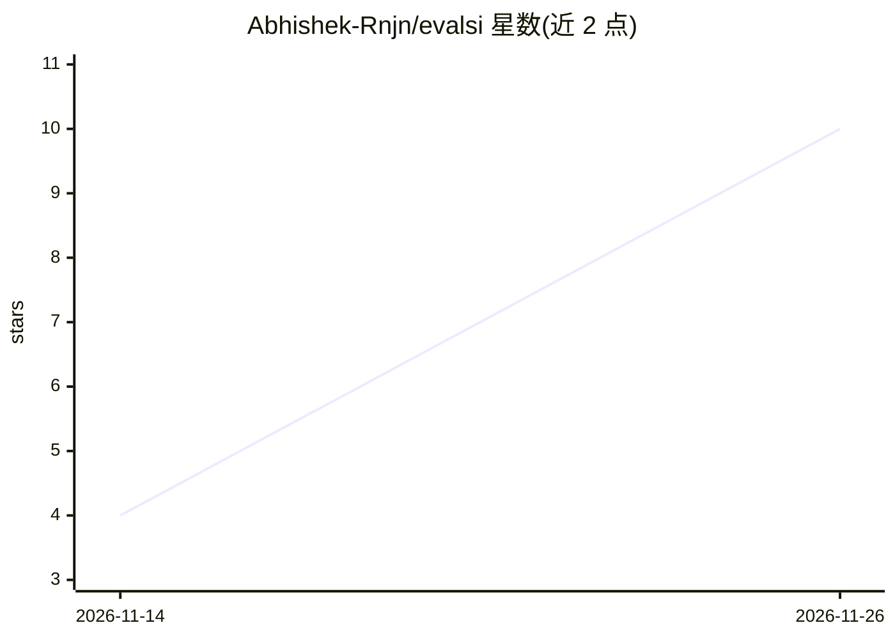

# Abhishek-Rnjn/evalsi

⭐ 10 · Python · Apache-2.0 · 推送 2026-11-24 · [GitHub](https://github.com/Abhishek-Rnjn/evalsi) · [官网](https://evalsi.dev) · 个人维护

**AI 系统评估流水线：CI 门禁、在线打分与 RL 奖励复用同一套评估器**

以 SDK（pip 安装）与可选服务端形式提供的评估框架：发布前在数据集与沙箱任务上运行 agent、RAG 管道和模型并在门禁失败时中断构建；运行时对在线 trace 打分并写回 MLflow、Phoenix、Langfuse；训练时同一评估器作为 TRL/verl/OpenRLHF 的 RL 奖励与 checkpoint 回归检查。评估器可插拔（Python 函数或 Wasm 模块），支持 lm-evaluation-harness、Inspect AI、RAGAS、DeepEval 作为隔离适配器；快速入门仅需 Python 3.11+，无需服务器、Docker 或 API key。

## 筛选速览

| 维度 | 判定 | 备注 |
|---|---|---|
| AI 角色 | `ai-ecosystem` | LLM/agent 周边工具 |
| 许可风险 | `permissive` | Apache-2.0 |
| 部署形态 | `desktop` | 安装包/桌面程序 |
| 模型依赖 | — | README 未给出锁定关系 |
| 硬件要求 | — | 无带数字的原话,不猜 |
| 安装摩擦 | `low` | 无编译、无系统依赖或容器化 |
| 成熟度 | — | 结构信号不足 |

## 能力要点

- 发布前 CI 门禁、运行时 trace 打分、训练期 RL 奖励复用同一评估器
- 自带 agent harness：沙箱任务、隐藏检查器、pass@k/pass^k 试验
- RAG 指标区分检索（context-precision/recall）与生成（faithfulness 等），citation-accuracy 无需 judge
- 支持 OpenTelemetry 写入，trace 源读写 MLflow/Phoenix/Langfuse/LangSmith/ClickHouse

## 适用场景

- 在 CI 中对 agent 与 RAG 管道设置回归门禁
- 对生产环境在线 trace 打分并写回既有 trace 存储
- 为微调与 RL 训练提供可组合的奖励函数与 checkpoint 检查
- 在自托管或离线环境中沙箱运行评估

## 场景标签

`模型评测` `强化学习` · 领域:评测与运维

## 证据(README 行号)

> L5: Agents, RAG pipelines, LLMs and models on one set of evaluators: sandboxed runs and CI gates, live trace scoring, an
> L25: Evalsi evaluates an AI system across its life. **Before you ship**, it runs agents, RAG pipelines and models on dat
> L172: - **Pluggable.** lm-evaluation-harness, Inspect AI, RAGAS and DeepEval run as isolated adapters; your own evaluato

## 星数曲线

2026-11-14 4 → 2026-11-26 10（+6）

---
*卡片 v1 · prompt 1.4 · 生成 2026-11-26 · 置信度 mid · 依据 README sha `77596e48ba91` · [字段定义](../../DATASET.md)*
