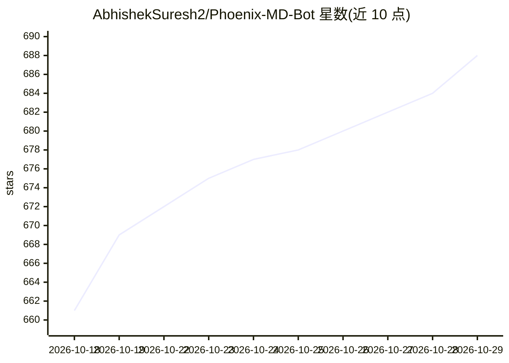

# AbhishekSuresh2/Phoenix-MD-Bot

⭐ 688 · JavaScript · Apache-2.0 · 推送 2026-06-13 · [GitHub](https://github.com/AbhishekSuresh2/Phoenix-MD-Bot) · 个人维护

**WhatsApp 多设备机器人脚本，支持多平台一键部署**

Phoenix-MD 是一个基于 Node.js 的 WhatsApp Multi-Device 机器人，通过 Fork 仓库、绑定账号并接入外部插件的方式使用。README 提供八种部署途径：GitHub Actions、Codespace、Heroku、Render、Koyeb、Railway、Replit 等，均以注册账号后部署仓库的方式运行；其中 Replit 与 Railway 用户需配合 Uptimer Robot 保持 24/7 在线。代码附带强制署名条款，禁止去除作者标注或再分发。具体功能清单 README 未展开，仓库主题标签含 ai/automation。

## 筛选速览

| 维度 | 判定 | 备注 |
|---|---|---|
| AI 角色 | `ai-enhanced` | 去掉 AI 部分产品仍成立 |
| 许可风险 | `permissive` | Apache-2.0 |
| 部署形态 | `None` |  |
| 模型依赖 | — | README 未给出锁定关系 |
| 硬件要求 | — | 无带数字的原话,不猜 |
| 安装摩擦 | `low` | 无编译、无系统依赖或容器化 |
| 成熟度 | — | 结构信号不足 |

## 能力要点

- WhatsApp Multi-Device 机器人，外部插件机制
- 支持 GitHub Actions/Codespace/Heroku/Render/Koyeb/Railway/Replit 等多种部署途径
- 附社区更新频道与支持群组

## 适用场景

- 部署一个可长期在线的个人 WhatsApp 机器人
- 通过外部插件扩展机器人功能
- 选择免费或低成本云平台托管运行

## 场景标签

 · 领域:即时通讯/机器人

## 证据(README 行号)

> L17:  Phoenix-MD-Bot: A powerful, feature-rich WhatsApp Multi-Device Bot.
> L23: |**01**|**Fork the Repo**||

## 星数曲线

2026-10-18 661 → 2026-10-29 688（+27）

---
*卡片 v1 · prompt 1.4 · 生成 2026-10-21 · 置信度 low · 依据 README sha `61c348f81161` · [字段定义](../../DATASET.md)*
