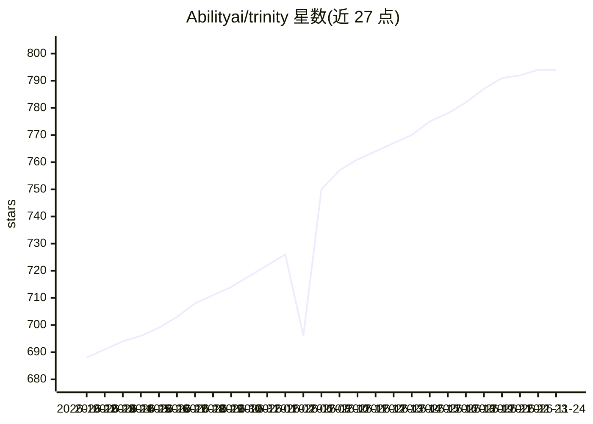

# Abilityai/trinity

⭐ 794 · Python · Apache-2.0 · 推送 2026-11-22 · [GitHub](https://github.com/Abilityai/trinity) · [官网](https://www.ability.ai/trinity) · 组织维护

**自托管 AI Agent 平台：为企业运行、治理持久化 agent 舰队**

Trinity 是一个开源自托管的 agent 编排平台：agent 以容器运行，可挂在部门与角色结构下，通过调度、循环、agent 间调用进行编排；不可逆操作经人工审批门（Inbox 审批卡），所有工具调用写入只追加审计日志，agent 状态以 git 仓库形式由用户持有。运行时支持 Claude Code、OpenAI Codex、Gemini CLI 三种，聊天内可切换。Apache 2.0 开源全部平台功能，Enterprise 通过可选私有子模块提供 SSO、RBAC、合规导出等治理功能。部署依赖 Docker 与 Docker Compose v2。

## 筛选速览

| 维度 | 判定 | 备注 |
|---|---|---|
| AI 角色 | `ai-ecosystem` | LLM/agent 周边工具 |
| 许可风险 | `permissive` | Apache-2.0 |
| 部署形态 | `self-host` | docker 或自建部署 |
| 模型依赖 | — | README 未给出锁定关系 |
| 硬件要求 | — | 无带数字的原话,不猜 |
| 安装摩擦 | `low` | 无编译、无系统依赖或容器化 |
| 成熟度 | — | 结构信号不足 |

## 能力要点

- agent 状态为用户持有的 git 仓库，工具调用写入 append-only 审计日志
- gated skill 审批门：请求在 agent 看到前冻结，审批人经 Inbox 处理
- 三种运行时（Claude Code/Codex/Gemini CLI），per-chat 模型选择器
- Cornelius 认知架构将运行经验沉淀为仓库内文件

## 适用场景

- 自托管运行有角色与汇报线的多 agent 团队
- 需要人工审批门与审计日志的 agent 治理场景
- 让编码 agent 打包并部署业务 agent 到平台

## 场景标签

`多智能体` `Agent 框架` · 领域:Agent 开发

## 证据(README 行号)

> L21: **Trinity is the operating system for the AI-native company - that you own.**
> L120: Three runtimes - Claude Code, OpenAI Codex, Gemini CLI - and a model picker per chat. Each agent is its own contai
> L163: |**Open source - Apache 2.0, free**|**Enterprise adds**|

## 星数曲线

2026-10-22 688 → 2026-11-24 794（+106）

---
*卡片 v1 · prompt 1.4 · 生成 2026-11-24 · 置信度 mid · 依据 README sha `36cc61ad1dbc` · [字段定义](../../DATASET.md)*
