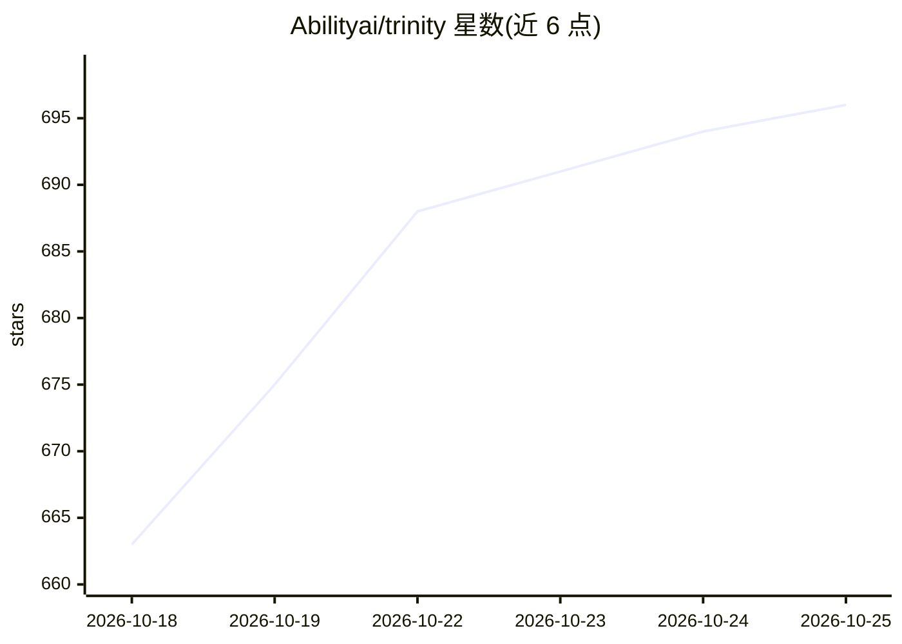

# Abilityai/trinity

⭐ 699 · Python · Apache-2.0 · 推送 2026-10-24 · [GitHub](https://github.com/Abilityai/trinity) · [官网](https://www.ability.ai/trinity) · 组织维护

**企业自托管 AI Agent 平台：编排、治理并运行编码 Agent**

Apache 2.0 开源的自托管 AI Agent 平台，面向以 AI 为核心的组织。它作为运行时编排层，在生产环境中运行 Claude Code、OpenAI Codex、Gemini CLI 三种编码 Agent，将 Agent 按部门与角色组织，提供审批门（Inbox 人工批准）、Git 化 Agent 状态、防篡改审计日志、成本与循环预算护栏，以及 Slack/Telegram/WhatsApp/语音/MCP 等多渠道接入。每个 Agent 运行在独立容器中，凭据加密。Cornelius 认知架构将运行经验沉淀为仓库文件。企业版以 Open Core 子模块形式叠加 SSO、RBAC 等治理功能。

## 筛选速览

| 维度 | 判定 | 备注 |
|---|---|---|
| AI 角色 | `ai-ecosystem` | LLM/agent 周边工具 |
| 许可风险 | `permissive` | Apache-2.0 |
| 部署形态 | `self-host` | docker 或自建部署 |
| 模型依赖 | locked-api |  |
| 硬件要求 | — | 无带数字的原话,不猜 |
| 安装摩擦 | `low` | 无编译、无系统依赖或容器化 |
| 成熟度 | — | 结构信号不足 |

## 能力要点

- 运行 Claude Code / OpenAI Codex / Gemini CLI 三种运行时，按聊天选择模型
- 不可逆操作经门控技能等待人工审批（Inbox：Approve/Discuss/Reject）
- Agent 即 Git 仓库：提交历史、仅追加审计日志、可选 SHA-256 哈希链
- 一键脚本或 Docker Compose 部署，支持 DigitalOcean/AWS/Vultr 云镜像

## 适用场景

- 把编码 Agent 从本机控制台迁移到带权限与审计的生产运行环境
- 为多个 Agent 建立部门、角色、目标与审批流程的治理结构
- 在自有基础设施上运行 Agent 并保留全部数据与凭据
- 跨 Slack/Telegram/WhatsApp/语音/MCP 统一使用同一批 Agent

## 场景标签

`多智能体` `编码 Agent` · 领域:Agent 开发

## 证据(README 行号)

> L26: *Your coding agent writes the agent. Trinity runs it in production - with state, permissions and receipts.* It runs
> L119: Three runtimes - Claude Code, OpenAI Codex, Gemini CLI - and a model picker per chat. Each agent is its own contai
> L162: |**Open source - Apache 2.0, free**|**Enterprise adds**|

## 星数曲线

2026-10-18 663 → 2026-10-25 696（+33）

---
*卡片 v1 · prompt 1.4 · 生成 2026-10-21 · 置信度 mid · 依据 README sha `2c6b10159473` · [字段定义](../../DATASET.md)*
