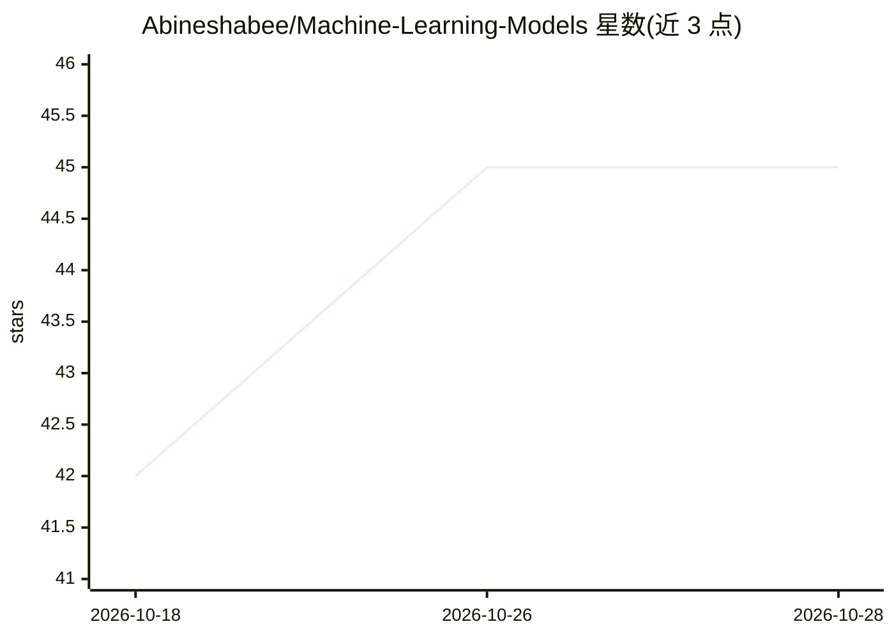

# Abineshabee/Machine-Learning-Models

⭐ 45 · Jupyter Notebook · 推送 2026-03-08 · [GitHub](https://github.com/Abineshabee/Machine-Learning-Models) · 个人维护

**机器学习练习仓库：多数据集的分类与预测实验集**

个人学习归档性质的机器学习实验仓库，含 6 个 Jupyter Notebook 项目：DDoS 攻击检测、URL 垃圾检测、澳大利亚降雨预测、糖尿病预测、声纳物体识别（矿石/岩石）与车辆排放预测。各项目遵循数据加载、预处理、特征分析、模型训练与评估的统一流程，使用 Python、Pandas、NumPy、Scikit-learn 等工具。README 未给出安装或运行命令，仓库以 Notebook 形式提供。

## 筛选速览

| 维度 | 判定 | 备注 |
|---|---|---|
| AI 角色 | `ai-knowledge` | 知识聚合/清单类 |
| 许可风险 | `none` | — |
| 部署形态 | `None` |  |
| 模型依赖 | — | README 未给出锁定关系 |
| 硬件要求 | — | 无带数字的原话,不猜 |
| 安装摩擦 | `low` | 无编译、无系统依赖或容器化 |
| 成熟度 | — | 结构信号不足 |

## 能力要点

- 覆盖 6 个真实数据集的分类/预测项目
- 统一 ML 工作流：加载→清洗→特征→训练→评估
- 探索 Logistic Regression、决策树、SVM、KNN 等算法

## 适用场景

- 学习并复现典型分类与预测项目的工作流
- 参考不同数据集上的预处理与特征工程做法
- 在 Jupyter 中练习 Scikit-learn 模型构建与评估

## 场景标签

 · 领域:机器学习/数据科学

## 证据(README 行号)

> L3: This repository contains a collection of **machine learning projects and experiments** developed for **learning and 
> L251: It acts as a **practice environment for building and testing machine learning models**.

## 星数曲线

2026-10-18 42 → 2026-10-28 45（+3）

---
*卡片 v1 · prompt 1.4 · 生成 2026-10-25 · 置信度 mid · 依据 README sha `de9095753e10` · [字段定义](../../DATASET.md)*
