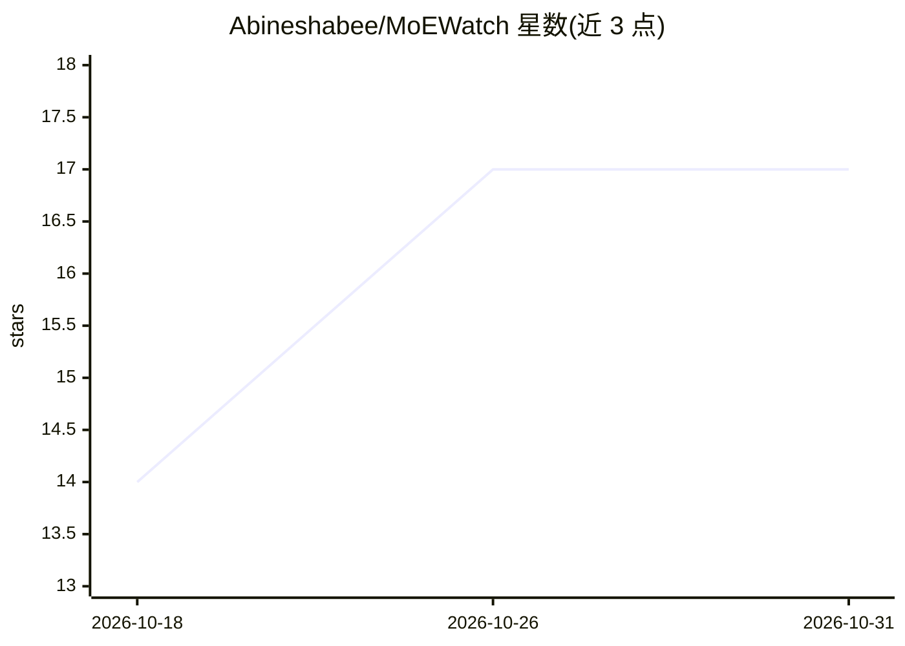

# Abineshabee/MoEWatch

⭐ 17 · Python · Apache-2.0 · 推送 2026-10-21 · [GitHub](https://github.com/Abineshabee/MoEWatch) · 个人维护

**MoE 模型训练诊断库：检测专家坍缩与路由失衡**

面向 HuggingFace Transformers 下 Mixture-of-Experts 模型的诊断与审计 Python 库。通过零权重修改的 PyTorch hook 侵入路由模块，聚合路由统计，输出专家坍缩（死/冷专家）、路由熵坍缩与负载失衡的结构化告警（INFO/WARN/ERROR）。支持 Mixtral、OLMoE、DeepSeek-MoE、Qwen-MoE、Phi-MoE、Switch Transformer 等架构自动识别，未知架构回退启发式扫描。提供一次性 audit() 离线诊断与训练时实时监控两种模式，可作为 TrainerCallback 一行接入；环形缓冲固定内存占用，采样率可配置开销。

## 筛选速览

| 维度 | 判定 | 备注 |
|---|---|---|
| AI 角色 | `ai-ecosystem` | LLM/agent 周边工具 |
| 许可风险 | `permissive` | Apache-2.0 |
| 部署形态 | `library` | 以包/库形式分发 |
| 模型依赖 | — | README 未给出锁定关系 |
| 硬件要求 | — | 无带数字的原话,不猜 |
| 安装摩擦 | `low` | 无编译、无系统依赖或容器化 |
| 成熟度 | — | 结构信号不足 |

## 能力要点

- 专家坍缩/路由熵坍缩/负载失衡三级结构化告警
- 零权重修改的 PyTorch hook 原理，不中断训练
- 8 类 MoE 架构自动识别，自定义架构可配置 router_modules
- 一次性 audit() 与实时监控两种模式，支持 TrainerCallback 接入

## 适用场景

- MoE 模型训练中及早发现专家坍缩或路由分布异常
- 离线审计已有模型的路由健康度
- 生产训练中低成本采样监控路由统计

## 场景标签

`LLM 可观测性` `MLOps` · 领域:评测与运维

## 证据(README 行号)

> L10: MoEWatch is a lightweight diagnostic and audit library for MoE models in HuggingFace Transformers. Drop it into any
> L18: - **Two integration modes** — one-shot `audit()` for offline diagnostics, or `MoEWatch` for live training-time moni
> L19: - **HuggingFace `Trainer` support** — attach as a `TrainerCallback` with one line

## 星数曲线

2026-10-18 14 → 2026-10-31 17（+3）

---
*卡片 v1 · prompt 1.4 · 生成 2026-10-30 · 置信度 high · 依据 README sha `d6a8cb7bd653` · [字段定义](../../DATASET.md)*
