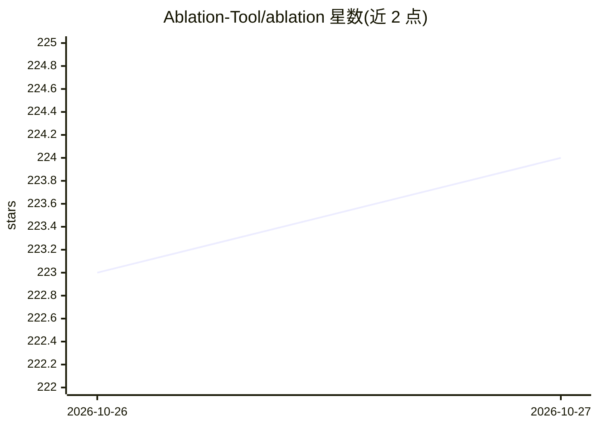

# Ablation-Tool/ablation

⭐ 224 · Python · NOASSERTION · 推送 2026-10-26 · [GitHub](https://github.com/Ablation-Tool/ablation) · 组织维护 · 中文 README

**AI 辅助逆向工程框架：用 agent 与图分析解析二进制**

Ablation 是面向二进制与固件分析的 AI 辅助逆向工程（AIARE）框架，以 Python/CLI 形式提供。核心引擎覆盖 39 种反编译目标（x86/ARM/MIPS/LoongArch64 等原生 CPU、车用 ECU ISA、DEX/BEAM/.pyc 等运行时），实现二进制提升到中间表示、CFG/数据流/结构化恢复、符号寄存器溯源、熵映射、Unicorn 动态沙箱与加密审计。AI 侧采用 Agentic GraphRAG 与 ReAct 式 LLM 分析师循环：模型自主选择工具、迭代推理，配语义代码搜索（bge-small 嵌入）、漏洞假设引擎与证据评分，支持跨目标模式复用。

## 筛选速览

| 维度 | 判定 | 备注 |
|---|---|---|
| AI 角色 | `ai-native` | 本体是模型或模型工具 |
| 许可风险 | `none` | NOASSERTION |
| 部署形态 | `self-host` | docker 或自建部署 |
| 模型依赖 | — | README 未给出锁定关系 |
| 硬件要求 | — | 无带数字的原话,不猜 |
| 安装摩擦 | `low` | 无编译、无系统依赖或容器化 |
| 成熟度 | — | 结构信号不足 |

## 能力要点

- 覆盖 39 种反编译目标，含原生 CPU、车用 ECU 与多种 VM/运行时字节码
- Agentic GraphRAG + ReAct LLM 分析师循环自主规划逆向步骤
- 符号寄存器/溯源/ARM64 符号切片等静态污点分析机制
- 假设引擎与证据评分驱动漏洞分析，状态跨会话持久化

## 适用场景

- 分析剥离符号的二进制与无 ELF 头的固件 ROM
- 对固件/恶意样本做漏洞假设生成与证据收集
- 跨版本复用已确认的漏洞模式加速同族目标分析

## 场景标签

`网络安全` · 领域:学习与行业

## 证据(README 行号)

> L5: Ablation is an AI-assisted reverse engineering (AIARE) framework.
> L52: |**Agentic GraphRAG**|1&nbsp;2|Agentic GraphRAG merges knowledge graphs (structured nodes and edges) with autonomou
> L74: |**LLM Analyst Loop & RAG**|1&nbsp;2|An LLM analyst loop runs a bounded tool-calling cycle where the model selects 

## 星数曲线

2026-10-26 223 → 2026-10-27 224（+1）

---
*卡片 v1 · prompt 1.4 · 生成 2026-10-25 · 置信度 low · 依据 README sha `3b0e8f4496b7` · [字段定义](../../DATASET.md)*
