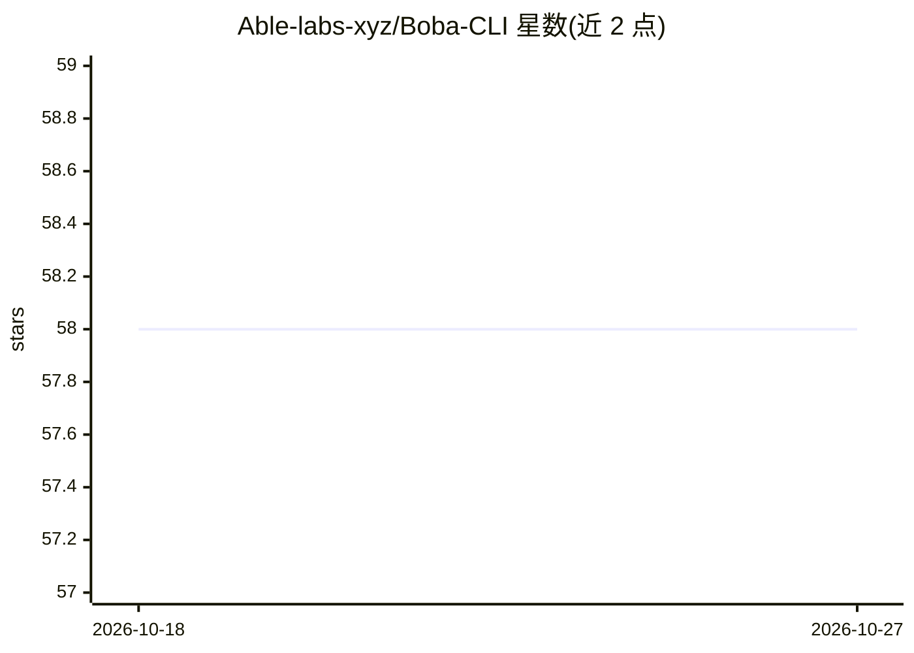

# Able-labs-xyz/Boba-CLI

⭐ 58 · Go · MIT · 推送 2026-02-10 · [GitHub](https://github.com/Able-labs-xyz/Boba-CLI) · [官网](https://agents.boba.xyz/) · 组织维护

**连接 Claude 与 Boba 去中心化交易的 CLI 代理工具**

面向使用 Claude 的加密交易用户的命令行工具：通过 npm 分发（v0.3.0 起为原生 Go 二进制），在本地运行代理，使 Claude 经 Boba MCP 后端调用交易 API，同时 Claude 不接触凭证。凭证存于 OS Keychain，代理用每会话 token 认证，后端通信强制 HTTPS，工具调用全程留审计日志。支持 Claude Code 与 Claude Desktop 两种安装模式，提供交互式 TUI 菜单与 iTerm 启动选项。

## 筛选速览

| 维度 | 判定 | 备注 |
|---|---|---|
| AI 角色 | `ai-ecosystem` | LLM/agent 周边工具 |
| 许可风险 | `permissive` | MIT |
| 部署形态 | `library` | 以包/库形式分发 |
| 模型依赖 | locked-api |  |
| 硬件要求 | — | 无带数字的原话,不猜 |
| 安装摩擦 | `low` | 无编译、无系统依赖或容器化 |
| 成熟度 | — | 结构信号不足 |

## 能力要点

- 本地代理架构：Claude 不见凭证，可随时停止代理撤销访问
- 凭证存 OS Keychain，代理采用每会话 token 认证
- 所有工具调用留审计日志
- 支持 Claude Code 与 Claude Desktop 两种接入方式

## 适用场景

- 让 Claude 代为执行 Boba 平台上的交易操作
- 以凭证隔离方式让 AI 代理访问交易 API
- 随时审计和撤销 AI 代理的交易访问权限

## 场景标签

 · 领域:加密货币交易/AI 代理基础设施

## 证据(README 行号)

> L7:  Connect Claude to Boba trading in seconds.
> L56: │   Claude    │ ───▶ │  Boba CLI   │ ───▶ │  Boba MCP   │

## 星数曲线

2026-10-18 58 → 2026-10-27 58（+0）

---
*卡片 v1 · prompt 1.4 · 生成 2026-10-24 · 置信度 high · 依据 README sha `8a378e36531f` · [字段定义](../../DATASET.md)*
