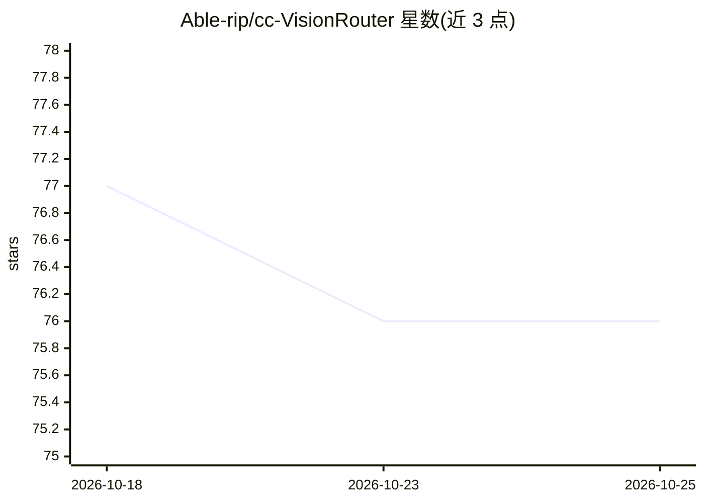

# Able-rip/cc-VisionRouter

⭐ 76 · JavaScript · MIT · 推送 2026-06-07 · [GitHub](https://github.com/Able-rip/cc-VisionRouter) · 个人维护 · 中文 README

**Claude Code 透明代理：含图请求自动分流到多模态模型，防长任务崩断**

夹在 Claude Code 与上游 API 之间的透明代理，实现按内容分流：检测请求中是否含 image/document 块，含图的请求（含背景压缩任务）路由到用户指定的多模态模型，纯文本请求走主力模型，避免不支持多模态的第三方模型在长程任务中因图片崩溃。自动改写模型名、剥离 [1m] 后缀、改写并还原 ~/.claude/settings.json。仅支持 Anthropic Messages API 格式上游，不支持 OpenAI 格式；API key 以明文存储。面向用第三方模型跑 Claude Code 长任务的开发者，提供 npm 全局安装与 CLI。

## 筛选速览

| 维度 | 判定 | 备注 |
|---|---|---|
| AI 角色 | `ai-ecosystem` | LLM/agent 周边工具 |
| 许可风险 | `permissive` | MIT |
| 部署形态 | `library` | 以包/库形式分发 |
| 模型依赖 | — | README 未给出锁定关系 |
| 硬件要求 | — | 无带数字的原话,不猜 |
| 安装摩擦 | `low` | 无编译、无系统依赖或容器化 |
| 成熟度 | — | 结构信号不足 |

## 能力要点

- 按 image/document 块检测做二元路由，背景/压缩请求自动走视觉模型
- 自动改写模型名与剥离 [1m] 后缀，start/stop 时备份还原 settings.json
- 配置保存前用 max_tokens:1 最小请求自检连通性
- SSE 流式透传，429/503 自动退避重试一次

## 适用场景

- 用不支持多模态的第三方模型在 Claude Code 里跑长程任务
- 避免 /compact 压缩含图历史时模型报错崩断会话
- 希望不手动 /model 切换就自动处理图片请求

## 场景标签

`模型网关` · 领域:Agent 开发

## 证据(README 行号)

> L24: cc-VisionRouter 是夹在 Claude Code 和上游之间的**透明代理**。它不替你换模型、不打断你的工作流，只做一件事——**看每个请求里有没有图片，再决定送给谁**：
> L116: 本工具是 **Anthropic Messages API**（`/v1/messages`）的透明代理，只改 `model` 字段做路由，其余原样转发。

## 星数曲线

2026-10-18 77 → 2026-10-25 76（-1）

---
*卡片 v1 · prompt 1.4 · 生成 2026-10-24 · 置信度 high · 依据 README sha `6a0a6d34ae35` · [字段定义](../../DATASET.md)*
