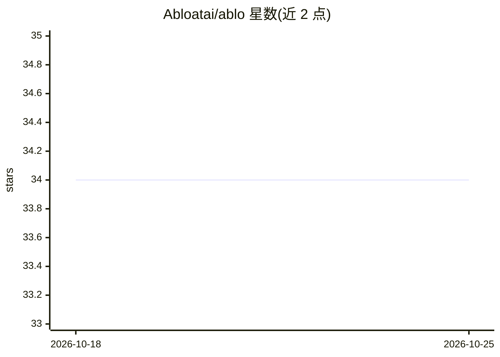

# Abloatai/ablo

⭐ 34 · TypeScript · Apache-2.0 · 推送 2026-10-22 · [GitHub](https://github.com/Abloatai/ablo) · [官网](https://www.abloatai.com/) · 组织维护

**多 Agent 并发协作的共享状态协调基础设施**

面向 AI 应用中人类、Agent、工作流与服务并发协作的场景，提供统一写入通道：权威性、幂等、冲突、顺序与确认在单点强制执行，Postgres 保持事实源。Groups 声明共享数据范围与参与者权限，claim 机制让长时间推理的 Agent 公平排队、失败自动释放、上下文过期时拒绝写入。以 npm 包提供，含 AI SDK 工具封装（readTool/updateTool 等），不提供搜索、记忆或模型运行时。

## 筛选速览

| 维度 | 判定 | 备注 |
|---|---|---|
| AI 角色 | `ai-ecosystem` | LLM/agent 周边工具 |
| 许可风险 | `permissive` | Apache-2.0 |
| 部署形态 | `library` | 以包/库形式分发 |
| 模型依赖 | — | README 未给出锁定关系 |
| 硬件要求 | — | 无带数字的原话,不猜 |
| 安装摩擦 | `low` | 无编译、无系统依赖或容器化 |
| 成熟度 | — | 结构信号不足 |

## 能力要点

- 所有写入经统一通道，强制幂等、冲突与顺序，Postgres 为事实源
- claim 机制支持长时推理的公平排队、自动释放与陈旧上下文拒绝写入
- 为 AI SDK 提供 readTool/createTool/updateTool/deleteTool 类型化工具
- 提供 @abloatai/ablo、/client、/react 多入口，共享同一 schema 与提交模型

## 适用场景

- 多 Agent 并发读写同一业务数据时避免覆盖冲突
- 为 AI SDK 模型暴露类型化的资源读写工具
- 人工与 Agent 协作编辑共享状态并保留归因记录

## 场景标签

`多智能体` · 领域:Agent 开发

## 证据(README 行号)

> L15: Ablo is coordination infrastructure for agents, applications, services, and
> L18: Every write goes through it, so authority, idempotency, conflicts, ordering,
> L88: Ablo supplies `readTool`, `createTool`, `updateTool`, and `deleteTool` over the

## 星数曲线

2026-10-18 34 → 2026-10-25 34（+0）

---
*卡片 v1 · prompt 1.4 · 生成 2026-10-25 · 置信度 high · 依据 README sha `9abe84726e1e` · [字段定义](../../DATASET.md)*
