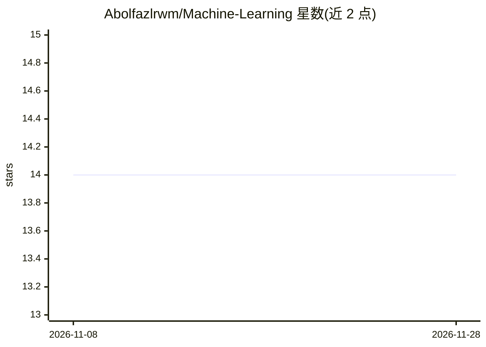

# Abolfazlrwm/Machine-Learning

⭐ 14 · Python · MIT · 推送 2026-11-25 · [GitHub](https://github.com/Abolfazlrwm/Machine-Learning) · [官网](https://abolfazlrwm.github.io/Machine-Learning/) · 个人维护

**机器学习作品集：从零实现的 GPT、波斯语 RAG、推荐系统等端到端项目**

包含六个端到端机器学习项目的集合：纯 NumPy 从零实现的 autograd 引擎与 decoder-only transformer（TinyGPT）、波斯语 RAG 助手（E5 嵌入 + FAISS 与自实现 BM25 经 RRF 融合，含查询扩展、答案缓存、注入防护与 RAGAS 式评测）、AI 文本检测、基于 ALS/SVD 矩阵分解的推荐系统、股票回测与垃圾短信分类。各项目带 src/ + tests/ 结构、pytest 套件（共 308 个测试）、CI 与文档站；统一 FastAPI 服务层支持 SSE 流式输出，并提供 Docker Compose 与 Hugging Face Spaces 浏览器端演示。面向学习与展示机器学习工程实践的开发者。

## 筛选速览

| 维度 | 判定 | 备注 |
|---|---|---|
| AI 角色 | `ai-native` | 本体是模型或模型工具 |
| 许可风险 | `permissive` | MIT |
| 部署形态 | `desktop` | 安装包/桌面程序 |
| 模型依赖 | local-ok | 支持本地模型 |
| 硬件要求 | — | 无带数字的原话,不猜 |
| 安装摩擦 | `low` | 无编译、无系统依赖或容器化 |
| 成熟度 | — | 结构信号不足 |

## 能力要点

- 纯 NumPy 从零实现 autograd 引擎 + decoder-only transformer，梯度校验误差约 1e-10
- 波斯语 RAG：E5 + FAISS 与自实现 BM25 经 RRF 融合，双查询扩展与注入防护
- FastAPI 统一服务层（SSE 流式、API-key 守卫、Prometheus 指标）
- Hugging Face Spaces 浏览器端演示，查询不离浏览器、零服务端推理

## 适用场景

- 学习 RAG 混合检索、重排与评测的完整工程实现
- 参考从零构建 autograd 与 transformer 的教学代码
- 部署波斯语文档问答服务或演示

## 场景标签

`RAG` `文档问答` `推荐系统` `金融量化` · 领域:知识与检索

## 证据(README 行号)

> L7: A collection of end-to-end machine learning projects — from classical
> L19: |`rag-farsi-assistant`|LLM / Retrieval (RAG)|Persian RAG: E5 embeddings + FAISS **fused with a from-scratch BM25 vi

## 星数曲线

2026-11-08 14 → 2026-11-28 14（+0）

---
*卡片 v1 · prompt 1.4 · 生成 2026-11-18 · 置信度 high · 依据 README sha `25a777ab1354` · [字段定义](../../DATASET.md)*
