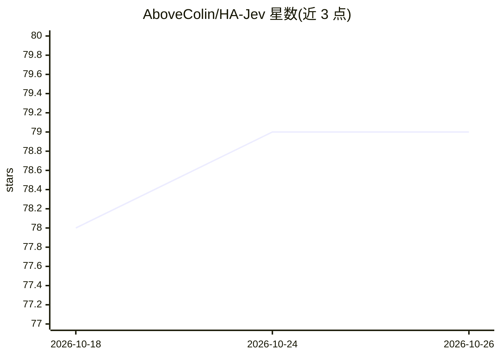

# AboveColin/HA-Jev

⭐ 79 · Python · MIT · 推送 2026-10-19 · [GitHub](https://github.com/AboveColin/HA-Jev) · [官网](https://jev.cdevries.dev/) · 个人维护

**Home Assistant 集成：向 TypeSafe Jev 提问并把回答变成实体**

连接 TypeSafe Jev 决策模型 API 的 Home Assistant 自定义组件：把 typed 问题（概率/选项/评分）的每个回答变成可自动化操作的传感器实体，提供 jev.noul/choice/score/ask/box 五个动作、一个 AI Task 实体和面向 Assist 的对话代理；支持附加摄像头快照供 jev.box 定位。附带维修检查、每日 token 预算与费用报告、25 个一键导入蓝图和 15 个示例。需 Home Assistant 2026.9+ 与 typesafe.ai 的 API key，经 HACS 或手动复制安装。

## 筛选速览

| 维度 | 判定 | 备注 |
|---|---|---|
| AI 角色 | `ai-native` | 本体是模型或模型工具 |
| 许可风险 | `permissive` | MIT |
| 部署形态 | `None` |  |
| 模型依赖 | — | README 未给出锁定关系 |
| 硬件要求 | — | 无带数字的原话,不猜 |
| 安装摩擦 | `low` | 无编译、无系统依赖或容器化 |
| 成熟度 | — | 结构信号不足 |

## 能力要点

- 每个问题的回答变成传感器实体（概率/选项/评分）
- jev.noul/choice/score/ask/box 五个动作可在自动化中调用并返回变量
- 面向 Assist 的对话代理与 AI Task 实体
- 25 个一键导入蓝图、每日 token 预算与费用报告

## 适用场景

- 把家中某项判断（如概率、选择）变成可自动化的实体
- 通过语音用 Assist 查询家居状态判断
- 用现成蓝图处理忘关洗衣机、开窗开暖气等场景

## 场景标签

`语音 Agent` · 领域:对话与助手

## 证据(README 行号)

> L11: Ask TypeSafe Jev questions about your house and get numbers
> L25: - Questions become sensors: a probability,
> L38: - A conversation agent for Assist routes

## 星数曲线

2026-10-18 78 → 2026-10-26 79（+1）

---
*卡片 v1 · prompt 1.4 · 生成 2026-10-24 · 置信度 high · 依据 README sha `afb9a71c1374` · [字段定义](../../DATASET.md)*
