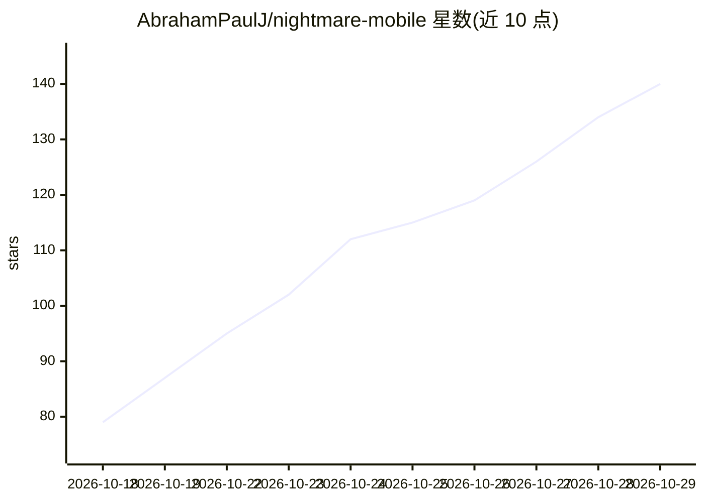

# AbrahamPaulJ/nightmare-mobile

⭐ 140 · Kotlin · NOASSERTION · 推送 2026-10-28 · [GitHub](https://github.com/AbrahamPaulJ/nightmare-mobile) · 个人维护

**安卓手机上跑图像/视频扩散模型的节点图应用（NPU）**

面向消费者的 Android 应用：以 ComfyUI 式节点图在 Qualcomm Hexagon NPU 上离线运行扩散模型，覆盖文生图、图生图、局部重绘/外扩、放大、图像编辑、文生视频与动作迁移。模型不随 APK 分发，按芯片分级支持（Snapdragon 888 起至 8 Elite），目录含 46 个 checkpoint（SD1.5/SDXL/FLUX.2 Klein/Z-Image/Qwen Image/MOSS/Ideogram 4 等），支持 LoRA、ControlNet、IP-Adapter、LivePortrait 面部编辑与动画、Florence-2/WD 反推提示词。通过 APK 安装。

## 筛选速览

| 维度 | 判定 | 备注 |
|---|---|---|
| AI 角色 | `ai-native` | 本体是模型或模型工具 |
| 许可风险 | `none` | NOASSERTION |
| 部署形态 | `None` |  |
| 模型依赖 | — | README 未给出锁定关系 |
| 硬件要求 | — | 无带数字的原话,不猜 |
| 安装摩擦 | `medium` | 含编译或系统依赖之一 |
| 成熟度 | `idea` | |

## 能力要点

- 节点图画布运行文生图/图生视频/动作迁移，全程离线
- 按 Snapdragon 芯片分级支持 46 个 checkpoint，含自带 GGUF/safetensors 导入
- LoRA 库、ControlNet、IP-Adapter、LivePortrait 面部编辑与肖像动画
- Florence-2 PromptGen 与 WD tagger 从图片反推提示词

## 适用场景

- 在手机上离线生成和编辑图片，无需服务器或账号
- 用文生视频与动作迁移在本地生成短视频
- 用 LoRA、ControlNet 和 IP-Adapter 精细控制生成结果

## 场景标签

`图像生成` `视频生成` · 领域:内容生成

## 证据(README 行号)

> L3: **A node graph for image and video generation on Android, running on the Qualcomm Hexagon NPU.**
> L4: Text to image, image to image, inpainting, upscaling, image editing, text to video and motion transfer. All on

## 星数曲线

2026-10-18 79 → 2026-10-29 140（+61）

---
*卡片 v1 · prompt 1.4 · 生成 2026-10-23 · 置信度 high · 依据 README sha `70317269d4fa` · [字段定义](../../DATASET.md)*
