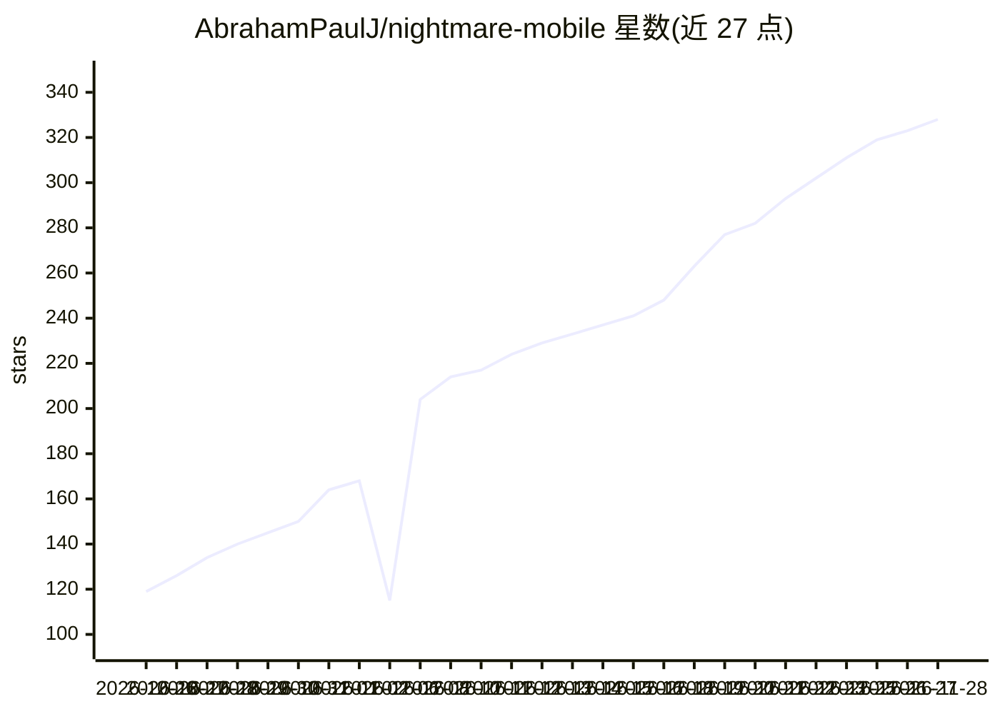

# AbrahamPaulJ/nightmare-mobile

⭐ 328 · Kotlin · NOASSERTION · 推送 2026-11-24 · [GitHub](https://github.com/AbrahamPaulJ/nightmare-mobile) · 个人维护

**安卓端 ComfyUI 式节点图应用：本地 NPU 跑图像/视频扩散模型**

面向 Android 的离线图像与视频生成应用：以触控友好的节点图组织扩散模型推理，支持 SD1.5、SDXL、FLUX、Z-Image、Qwen Image、Wan 2.2 视频等数十个模型，可在高通 Hexagon NPU 上运行。提供 inpaint/outpaint、ControlNet、LoRA、IP-Adapter 等编辑功能，直接导入 .safetensors/GGUF 微调模型，内置 CivitAI/Hugging Face 下载。引擎基于 Local Dream 分支与 stable-diffusion.cpp，附 85 个补丁。需 Android 12+ 与骁龙 Hexagon NPU；无骁龙芯片时仅支持部分 CPU/GPU 模型。

## 筛选速览

| 维度 | 判定 | 备注 |
|---|---|---|
| AI 角色 | `ai-native` | 本体是模型或模型工具 |
| 许可风险 | `none` | NOASSERTION |
| 部署形态 | `None` |  |
| 模型依赖 | — | README 未给出锁定关系 |
| 硬件要求 | — | 无带数字的原话,不猜 |
| 安装摩擦 | `medium` | 含编译或系统依赖之一 |
| 成熟度 | — | 结构信号不足 |

## 能力要点

- 触控节点图界面，含一步 Default 视图与结果还原为流程图
- Wan 2.2 14B 双专家从存储流式加载，可在 12 GB 手机运行
- NPU 诊断功能：逐部件回退 CPU 定位芯片错误来源
- 本地 API 兼容 AUTOMATIC1111 /sdapi/v1/txt2img，可作其他应用的后端

## 适用场景

- 在手机上完全离线生成图像和短视频
- 用节点图编排多模型与 LoRA、ControlNet 的生成流程
- 把手机作为本地图像生成 API 供其他应用调用

## 场景标签

`图像生成` `视频生成` · 领域:内容生成

## 证据(README 行号)

> L3: **ComfyUI-style image and video generation on an Android phone, running on the Snapdragon NPU.**
> L23: - **A real node graph, made for fingers**: ComfyUI's nodes and wires, with a one-step Default view when you just

## 星数曲线

2026-10-26 119 → 2026-11-28 328（+209）

---
*卡片 v1 · prompt 1.4 · 生成 2026-11-26 · 置信度 high · 依据 README sha `9d71593f07b9` · [字段定义](../../DATASET.md)*
