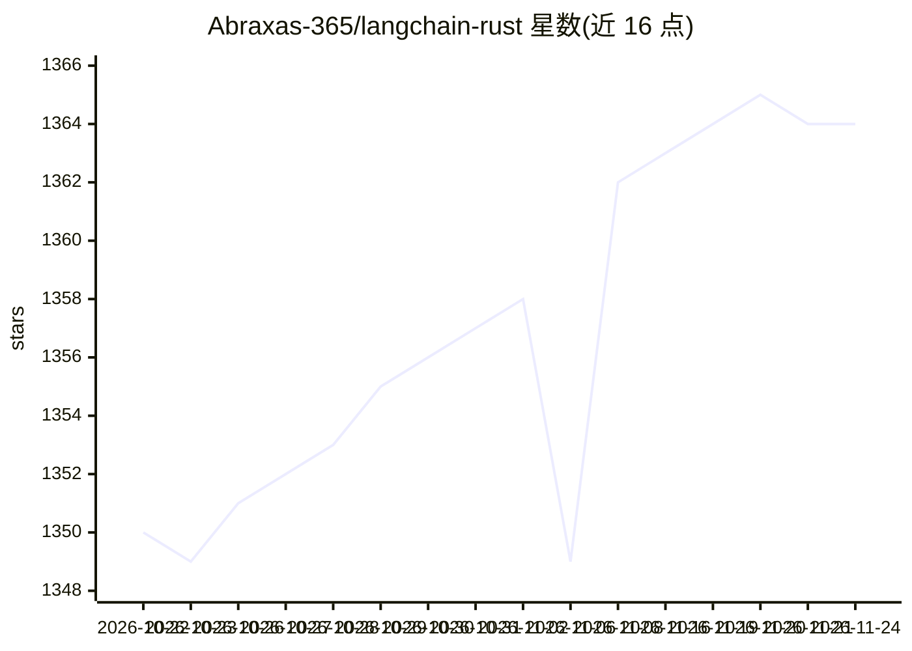

# Abraxas-365/langchain-rust

⭐ 1,364 · Rust · MIT · 推送 2026-11-15 · [GitHub](https://github.com/Abraxas-365/langchain-rust) · 组织维护

**为 Rust 开发者提供的 LangChain 框架实现**

LangChain 的 Rust 语言实现，以 crates.io 库形式分发。功能覆盖 LLM/嵌入模型接入、多种向量存储、链式编排（对话、SQL、Map-reduce、路由、Constitutional 等）、输出解析器、持久化记忆、带工具的 Agent 与多种文档加载器（PDF、HTML、CSV、Git commits、Notion 等）。安装通过 cargo add 完成，serde_json 为必需依赖，各向量存储以后端 feature flag 形式可选启用；sqlite-vss/sqlite-vec 需额外下载扩展库。

## 筛选速览

| 维度 | 判定 | 备注 |
|---|---|---|
| AI 角色 | `ai-ecosystem` | LLM/agent 周边工具 |
| 许可风险 | `permissive` | MIT |
| 部署形态 | `library` | 以包/库形式分发 |
| 模型依赖 | local-ok | 支持本地模型 |
| 硬件要求 | — | 无带数字的原话,不猜 |
| 安装摩擦 | `low` | 无编译、无系统依赖或容器化 |
| 成熟度 | — | 结构信号不足 |

## 能力要点

- 支持 14 种向量存储（MongoDB Atlas、Postgres、Qdrant、Milvus 等）
- 多种 Chain 编排：SQL、API、Router、Constitutional、Map-reduce 检索问答
- Agent 支持工具调用、ReAct 回退、流式事件与取消、tracing span
- 文档加载器覆盖 PDF/HTML/CSV/Git commits/Notion/AssemblyAI 转录

## 适用场景

- 用 Rust 构建 LLM 对话与检索问答应用
- 在 Rust 项目中为 Agent 接入多种模型与工具
- 为 Rust 应用添加文档摄取与向量检索能力

## 场景标签

`Agent 框架` `RAG` · 领域:Agent 开发

## 证据(README 行号)

> L13: This is the Rust language implementation of LangChain.
> L17: - LLMs

## 星数曲线

2026-10-22 1,350 → 2026-11-24 1,364（+14）

---
*卡片 v1 · prompt 1.4 · 生成 2026-11-23 · 置信度 high · 依据 README sha `b9c3f88fe998` · [字段定义](../../DATASET.md)*
