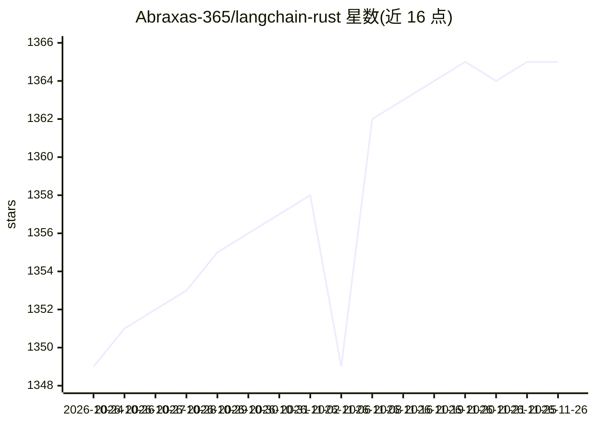

# Abraxas-365/langchain-rust

⭐ 1,365 · Rust · MIT · 推送 2026-11-23 · [GitHub](https://github.com/Abraxas-365/langchain-rust) · 组织维护

**LangChain 的 Rust 实现，供 Rust 开发者编写 LLM 应用**

LangChain 的 Rust 语言实现库：提供 LLM 调用（含响应缓存、prompt 缓存与 thinking 支持）、Embeddings、多种向量存储、Chain 编排（SQL/检索问答/路由/宪法链等）、输出解析器、持久化记忆、带工具的 Agent 及流式事件与 tracing。文档加载器覆盖 PDF、HTML、CSV、Git 提交、源码等格式。以 crate 形式分发，通过 cargo add 安装，向量存储等能力按 feature flag 启用。

## 筛选速览

| 维度 | 判定 | 备注 |
|---|---|---|
| AI 角色 | `ai-ecosystem` | LLM/agent 周边工具 |
| 许可风险 | `permissive` | MIT |
| 部署形态 | `library` | 以包/库形式分发 |
| 模型依赖 | local-ok | 支持本地模型 |
| 硬件要求 | — | 无带数字的原话,不猜 |
| 安装摩擦 | `low` | 无编译、无系统依赖或容器化 |
| 成熟度 | — | 结构信号不足 |

## 能力要点

- 支持 OpenAI/Azure/Ollama/Claude/DeepSeek 等多 LLM 接入及响应缓存
- 11 种向量存储后端（MongoDB Atlas/Pinecone/Qdrant/Redis 等）按 feature 启用
- Chain 覆盖 SQL、检索问答、路由、map-reduce、Constitutional 等
- Agent 支持流式事件、取消与 tracing spans

## 适用场景

- 用 Rust 编写基于 LLM 的对话/问答应用
- 在 Rust 项目中构建带工具调用的 Agent
- 对文档（PDF/HTML/CSV）做向量检索问答

## 场景标签

`Agent 框架` `RAG` · 领域:Agent 开发

## 证据(README 行号)

> L13: This is the Rust language implementation of LangChain.
> L52: - Chain
> L174: ## Installation

## 星数曲线

2026-10-24 1,349 → 2026-11-26 1,365（+16）

---
*卡片 v1 · prompt 1.4 · 生成 2026-11-25 · 置信度 high · 依据 README sha `c009c10da926` · [字段定义](../../DATASET.md)*
