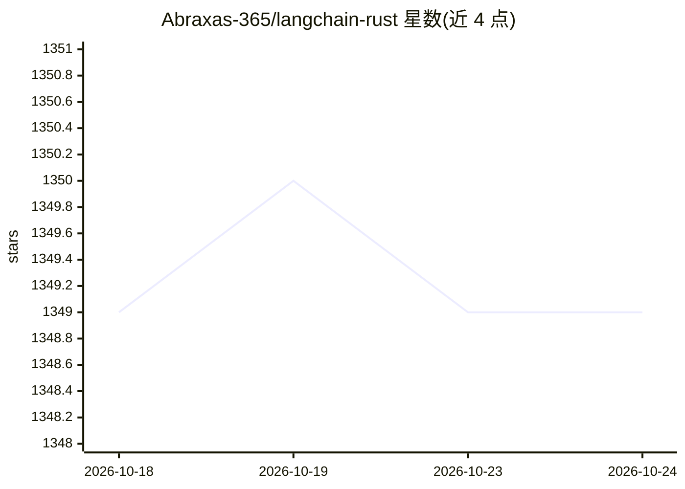

# Abraxas-365/langchain-rust

⭐ 1,349 · Rust · MIT · 推送 2026-10-24 · [GitHub](https://github.com/Abraxas-365/langchain-rust) · 个人维护

**LangChain 的 Rust 实现：用 Rust 组合式构建 LLM 应用**

以 Rust 语言实现 LangChain 的 LLM 应用构建库，面向 Rust 开发者。支持多种 LLM 提供商（OpenAI、Azure OpenAI、Ollama、Anthropic Claude）、多种 Embeddings 后端（含本地 FastEmbed）、向量存储（OpenSearch/Postgres/Qdrant/Sqlite/SurrealDB）、Chain 与 Agent、语义路由及 PDF/HTML/CSV/Git 提交等文档加载器。通过 cargo 以 feature flags 按需安装各后端，serde_json 为必需依赖。

## 筛选速览

| 维度 | 判定 | 备注 |
|---|---|---|
| AI 角色 | `ai-ecosystem` | LLM/agent 周边工具 |
| 许可风险 | `permissive` | MIT |
| 部署形态 | `library` | 以包/库形式分发 |
| 模型依赖 | local-ok | 支持本地模型 |
| 硬件要求 | — | 无带数字的原话,不猜 |
| 安装摩擦 | `low` | 无编译、无系统依赖或容器化 |
| 成熟度 | — | 结构信号不足 |

## 能力要点

- 支持 OpenAI、Azure OpenAI、Ollama、Anthropic Claude 四种 LLM 提供商
- 向量存储覆盖 OpenSearch、Postgres、Qdrant、Sqlite、SurrealDB（feature flags 按需启用）
- Chain、Agent（含工具调用）与语义路由（静态/动态）
- PDF/HTML/CSV/Git 提交/源码等多种文档加载器

## 适用场景

- 在 Rust 项目中构建对话链或检索问答应用
- 接入 Ollama 等本地或云端模型做 LLM 应用开发
- 用语义路由按用户意图分发请求

## 场景标签

`Agent 框架` `RAG` · 领域:Agent 开发

## 证据(README 行号)

> L5: ⚡ Building applications with LLMs through composability, with Rust! ⚡
> L12: This is the Rust language implementation of LangChain.

## 星数曲线

2026-10-18 1,349 → 2026-10-24 1,349（+0）

---
*卡片 v1 · prompt 1.4 · 生成 2026-10-21 · 置信度 high · 依据 README sha `23581bd6b7d5` · [字段定义](../../DATASET.md)*
