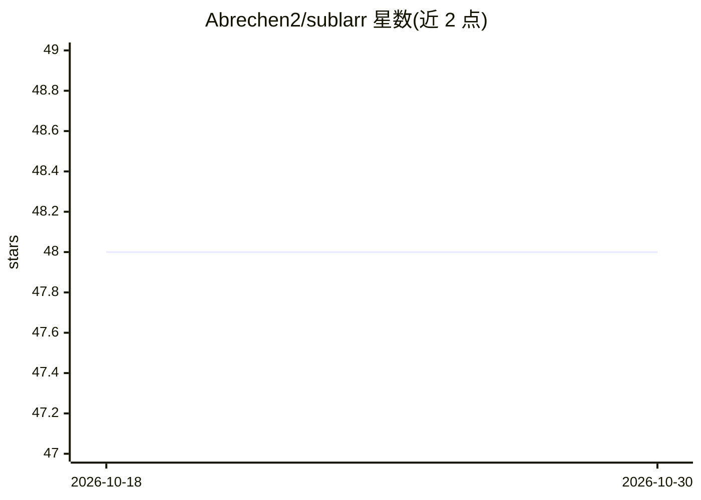

# Abrechen2/sublarr

⭐ 48 · Python · GPL-3.0 · 推送 2026-10-29 · [GitHub](https://github.com/Abrechen2/sublarr) · [官网](https://sublarr.de) · 个人维护

**自托管字幕管理与下载器，面向动画库，可选 LLM 翻译**

面向动画与媒体库的自托管字幕管理器：自动从 29 个内置字幕源（另 43 个可选源）并行搜索、打分（ASS 优先）并下载最匹配字幕，提供波形同步编辑器、格式转换、后处理流水线与 Whisper 兜底生成。支持 Sonarr/Radarr webhook 集成，也可独立运行（文件系统监听 + NFO 元数据）。LLM 翻译为实验性、默认关闭的可选功能，可通过 Ollama、DeepL、Google、LibreTranslate 或 OpenAI 兼容端点翻译字幕。Docker 为受支持的部署路径，单人维护，仅单共享密码认证、单实例单库。

## 筛选速览

| 维度 | 判定 | 备注 |
|---|---|---|
| AI 角色 | `ai-enhanced` | 去掉 AI 部分产品仍成立 |
| 许可风险 | `viral` | GPL-3.0 |
| 部署形态 | `self-host` | docker 或自建部署 |
| 模型依赖 | local-ok | 支持本地模型 |
| 硬件要求 | — | 无带数字的原话,不猜 |
| 安装摩擦 | `low` | 无编译、无系统依赖或容器化 |
| 成熟度 | `idea` | |

## 能力要点

- 29 个内置 + 43 个可选字幕源并行搜索，ASS 优先打分与上传者信任评分
- 波形同步编辑器、ASS/SRT 编辑、格式转换与 18 种后处理修复
- Sonarr/Radarr webhook 集成与无 *arr 的独立运行模式
- 可选实验性 LLM 翻译（Ollama/DeepL/Google/LibreTranslate/OpenAI 兼容端点），默认关闭

## 适用场景

- 动画库自动获取并同步字幕，处理绝对集数与多字幕轨
- 通过 Sonarr/Radarr webhook 自动为新导入内容下载字幕
- 用本地 LLM 对无字幕内容做可检视的机翻
- 编辑、修时与转换已有字幕文件

## 场景标签

`语音识别` · 领域:感知与多模态

## 证据(README 行号)

> L22: Sublarr is a self-hosted subtitle manager for anime and media libraries. It automatically searches subtitle provide
> L111: ### 🌐 LLM Translation *(optional · experimental · off by default)*
> L131: - **LLM translation is experimental and off by default.** Quality varies sharply by backend, model and language pa

## 星数曲线

2026-10-18 48 → 2026-10-30 48（+0）

---
*卡片 v1 · prompt 1.4 · 生成 2026-10-25 · 置信度 high · 依据 README sha `ffc4cd69bed3` · [字段定义](../../DATASET.md)*
