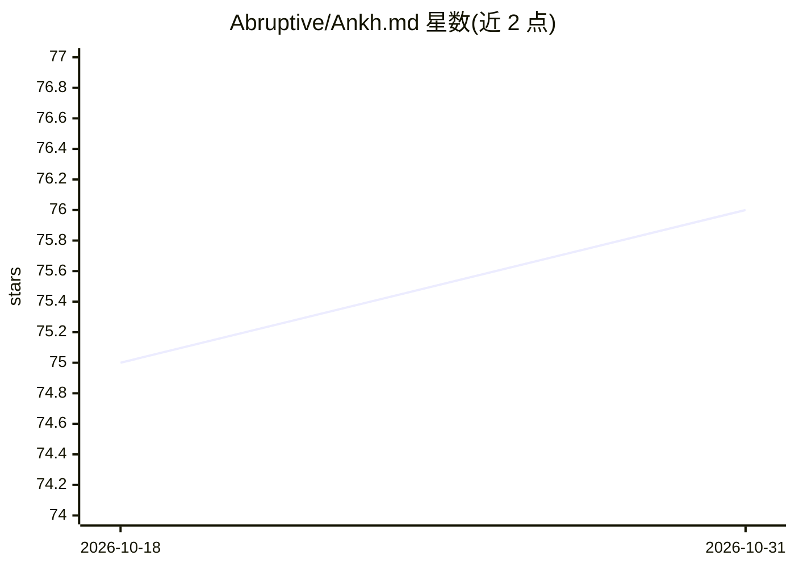

# Abruptive/Ankh.md

⭐ 76 · Shell · MIT · 推送 2026-03-15 · [GitHub](https://github.com/Abruptive/Ankh.md) · [官网](https://www.ankh.md) · 组织维护

**为 Hermes Agent 提供按项目作用域的多 agent 框架**

基于 Hermes Agent（Nous Research）的扩展框架：在含 .agent/ 目录的文件夹内运行 hermes 命令时，加载该文件夹专属的 agent 实例（独立配置、技能、会话与记忆），文件夹外仍运行默认 Hermes。机制上通过 bun bootstrap 下载并补丁 Hermes，部署到 ~/.agent/extensions/ankh，并做全局 ~/.hermes 与本地 .agent/config.yaml 的配置合并。仅测试 macOS；Gateway、cron、scoped auth 尚在开发且未测试；并非所有 Hermes 功能被支持。

## 筛选速览

| 维度 | 判定 | 备注 |
|---|---|---|
| AI 角色 | `ai-ecosystem` | LLM/agent 周边工具 |
| 许可风险 | `permissive` | MIT |
| 部署形态 | `None` |  |
| 模型依赖 | — | README 未给出锁定关系 |
| 硬件要求 | — | 无带数字的原话,不猜 |
| 安装摩擦 | `low` | 无编译、无系统依赖或容器化 |
| 成熟度 | `idea` | |

## 能力要点

- 按文件夹作用域隔离的 Hermes Agent 实例，配置/技能/会话/记忆存于 .agent/
- 全局 ~/.hermes 基线 + 本地 config.yaml 的逐项目配置合并
- ankh setup / uninstall 命令与 PATH 自动配置
- 内置 docs-explorer、web-researcher、diagram-maker 等 5 个示例 agent

## 适用场景

- 为每个代码仓库配置独立的编码 agent，避免项目间上下文污染
- 将 .agent/ 提交到 Git 与团队共享 agent 配置与技能
- 让主 agent 派生带不同工具集的子 agent 做研究/规划

## 场景标签

`Agent 框架` `多智能体` · 领域:Agent 开发

## 证据(README 行号)

> L3: **Ankh.md** (also known as Agent Ankh) is a 100% free, open-source, MIT-licensed agentic framework that helps you go
> L7: By default, Hermes Agent is a default experience you call from anywhere using `hermes`. After you install Ankh.md & 
> L50: However, if a valid Ankh `.agent` exists where you run your `hermes` command, the Ankh dynamically recognizes that 

## 星数曲线

2026-10-18 75 → 2026-10-31 76（+1）

---
*卡片 v1 · prompt 1.4 · 生成 2026-10-24 · 置信度 high · 依据 README sha `11788ed350b8` · [字段定义](../../DATASET.md)*
