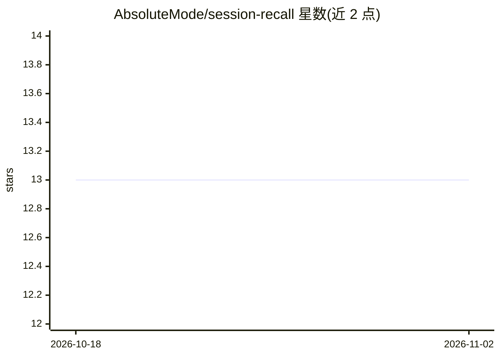

# AbsoluteMode/session-recall

⭐ 13 · Python · MIT · 推送 2026-10-25 · [GitHub](https://github.com/AbsoluteMode/session-recall) · 个人维护 · 中文 README

**给 Claude Code/Codex/Cursor 的共享语义记忆 MCP 工具**

把 Claude Code、Codex、Cursor 三家编程 agent 的本地会话历史索引为一份统一可检索的记忆，通过五个 MCP 工具（recall_search/expand_around/step/grep/recent_sessions）按语义或字面检索过往决策，并链接回原始对话轮次。本地优先：内置 ONNX 嵌入模型（bge-small 等）加 SQLite，无需 API key 即可用；可选接入 Voyage/OpenAI/Ollama/LM Studio 等 embedding 端点。仅嵌入对话文本，工具调用与推理数据不外发。安装方式为 pipx 从 GitHub 源码安装 CLI，再按各宿主装插件。

## 筛选速览

| 维度 | 判定 | 备注 |
|---|---|---|
| AI 角色 | `ai-ecosystem` | LLM/agent 周边工具 |
| 许可风险 | `permissive` | MIT |
| 部署形态 | `library` | 以包/库形式分发 |
| 模型依赖 | local-ok | 支持本地模型 |
| 硬件要求 | — | 无带数字的原话,不猜 |
| 安装摩擦 | `low` | 无编译、无系统依赖或容器化 |
| 成熟度 | — | 结构信号不足 |

## 能力要点

- 三款编程 agent 的历史统一为一份本地语义索引
- 五个 MCP 工具支持语义检索、原文定位与按仓库/来源/日期过滤
- 内置免费 ONNX 嵌入模型，无 key 可用，语义降级显式上报
- 增量索引按内容哈希复用向量，仅新增内容调用 embedding

## 适用场景

- 新会话恢复数周前其他 agent 做出的决策与上下文
- 修 bug 前检索历史会话确认该问题是否出现过及当时结论
- 在多个编程 agent 与订阅之间保留同一项目的连续记忆

## 场景标签

`Agent 记忆` `语义搜索` · 领域:Agent 开发

## 证据(README 行号)

> L18: Session Recall turns that history into one local-first index and serves it back through
> L19: five focused MCP tools. A fresh session can recover what Codex worked out yesterday and
> L60: |MCP tool|Use it when|

## 星数曲线

2026-10-18 13 → 2026-11-02 13（+0）

---
*卡片 v1 · prompt 1.4 · 生成 2026-10-31 · 置信度 mid · 依据 README sha `29a472645d4d` · [字段定义](../../DATASET.md)*
