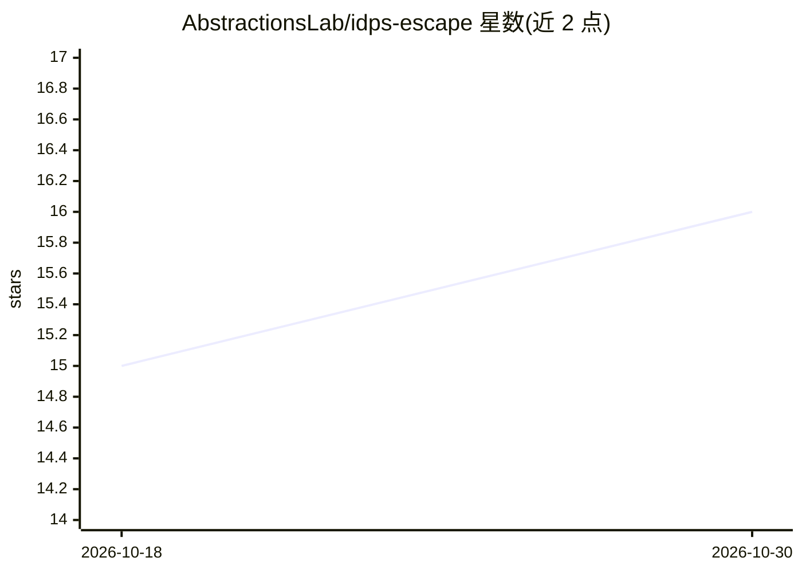

# AbstractionsLab/idps-escape

⭐ 16 · Python · AGPL-3.0 · 推送 2026-10-08 · [GitHub](https://github.com/AbstractionsLab/idps-escape) · [官网](https://abstractionslab.github.io/idps-escape/website/product-presentation.html) · 组织维护

**面向 SOC 的入侵检测防护系统：ML 异常检测加自动化响应**

CyFORT 子项目，基于 MAPE-K 架构的 SOAR 系统，面向 SME、CERT/CSIRT、SOC 管理员与安全工程师。核心组件 RADAR 在 Wazuh 之上叠加混合检测（签名式 Wazuh/Suricata + RRCF 随机森林流式异常检测）与分级自动响应（主机隔离、网络规则、告警升级、事件工单创建），通过浏览器 GUI 完成全栈部署与管理；SONAR 提供基于 MTAD-GAT 深度学习的多变量时间序列异常检测，支持实时/批式/历史模式。提供 Docker 构建脚本与 poetry 安装。限制：SONAR 处于 TRL 6，生产部署前需自行安全评估。

## 筛选速览

| 维度 | 判定 | 备注 |
|---|---|---|
| AI 角色 | `ai-native` | 本体是模型或模型工具 |
| 许可风险 | `viral` | AGPL-3.0 |
| 部署形态 | `None` |  |
| 模型依赖 | — | README 未给出锁定关系 |
| 硬件要求 | — | 无带数字的原话,不猜 |
| 安装摩擦 | `low` | 无编译、无系统依赖或容器化 |
| 成熟度 | `idea` | |

## 能力要点

- RADAR 混合检测 + 分级风险自动响应，浏览器 GUI 全栈部署管理
- SONAR 基于 MTAD-GAT 的多变量时间序列异常检测（实时/批式/历史）
- 与 Wazuh、OpenSearch、MISP、Flowintel、Suricata 集成
- SONAR 提供 debug 模式，无需基础设施即可离线跑通训练-检测-报告流程

## 适用场景

- SOC 团队部署带 ML 异常检测的入侵检测与自动响应系统
- 在 Wazuh 之上增加风险感知的自动处置（隔离主机、升级告警、建事件工单）
- 离线快速评估 SONAR 异常检测工作流

## 场景标签

`网络安全` · 领域:学习与行业

## 证据(README 行号)

> L15: We adopt a **hybrid detection approach** for defense-in-depth against known and emerging threats, combining signatu
> L46: - **Multivariate time series AD engine**: modular and optimized multivariate time-series detection based on MTAD-GA

## 星数曲线

2026-10-18 15 → 2026-10-30 16（+1）

---
*卡片 v1 · prompt 1.4 · 生成 2026-10-30 · 置信度 high · 依据 README sha `74ad73475949` · [字段定义](../../DATASET.md)*
