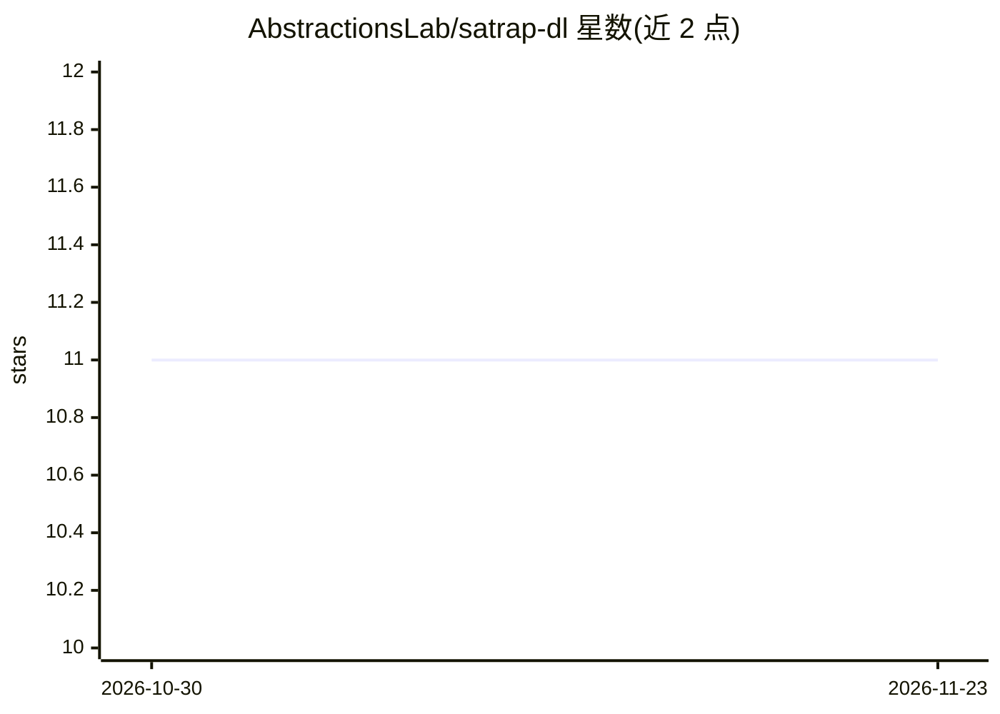

# AbstractionsLab/satrap-dl

⭐ 11 · Python · AGPL-3.0 · 推送 2026-11-17 · [GitHub](https://github.com/AbstractionsLab/satrap-dl) · [官网](https://abstractionslab.github.io/satrap-dl/website/product-presentation.html) · 组织维护

**面向 CTI 分析的半自动化威胁侦察与事件处置工具套件**

SATRAP-DL 套件包含两个子系统：SATRAP 提供基于知识表示系统（KRS）与可解释推理的 CTI 半自动分析平台，覆盖 ETL、CLI 与分析工具箱，处理 STIX 2.1 格式数据；DECIPHER 提供可扩展的 REST 服务，对告警信息做实时分析与严重度评分，并创建事件案例。仓库含源码、部署工件、用户手册、测试脚本与教程材料，支持 VS Code 容器化开发环境与统一测试脚本。PyFlowintel 库独立托管于另一仓库，用于通过 REST API 对接 Flowintel。

## 筛选速览

| 维度 | 判定 | 备注 |
|---|---|---|
| AI 角色 | `ai-native` | 本体是模型或模型工具 |
| 许可风险 | `viral` | AGPL-3.0 |
| 部署形态 | `None` |  |
| 模型依赖 | — | README 未给出锁定关系 |
| 硬件要求 | — | 无带数字的原话,不猜 |
| 安装摩擦 | `low` | 无编译、无系统依赖或容器化 |
| 成熟度 | — | 结构信号不足 |

## 能力要点

- SATRAP 基于知识表示系统做可解释推理，支持 STIX 2.1 CTI 数据
- DECIPHER 提供实时告警分析、严重度评分与事件案例创建的 REST 服务
- 仓库含统一测试脚本 run_tests.sh 覆盖两个子系统的单元与集成测试
- 提供 VS Code devcontainer 就绪的容器化开发环境

## 适用场景

- 对威胁情报进行半自动关联分析并得出可追溯的结论
- 对接 Flowintel 平台自动化事件处置流水线
- 对告警信息做实时分析与严重度评分

## 场景标签

`网络安全` · 领域:学习与行业

## 证据(README 行号)

> L15: - **SATRAP** provides a platform for (semi-)automated analysis of CTI based on a knowledge representation system fo
> L17: - **DECIPHER** provides an extensible REST service for real-time analysis and severity scoring of alert information

## 星数曲线

2026-10-30 11 → 2026-11-23 11（+0）

---
*卡片 v1 · prompt 1.4 · 生成 2026-11-19 · 置信度 mid · 依据 README sha `c1e048e3a80f` · [字段定义](../../DATASET.md)*
