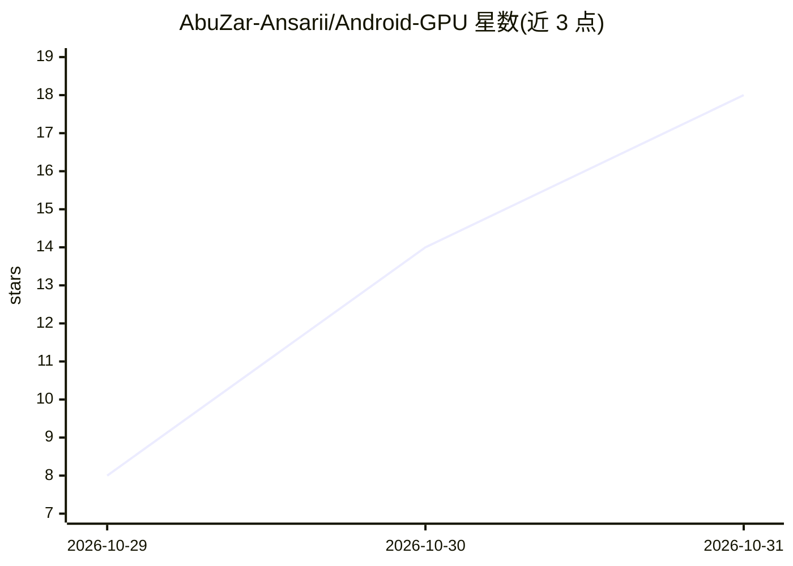

# AbuZar-Ansarii/Android-GPU

⭐ 18 · HTML · MIT · 推送 2026-10-27 · [GitHub](https://github.com/AbuZar-Ansarii/Android-GPU) · 个人维护

**把 Android 手机变成 PC 的离线 AI 加速器（本地 LLM 推理服务器）**

在 Android 手机端通过 Termux 编译并运行 llama.cpp，将 LLM 推理与内存占用完全放在手机上，PC 仅负责浏览器界面：经 USB（adb forward 8080）或局域网 Wi-Fi 访问手机上的 Web UI 与 OpenAI 兼容 API（/v1）。支持 Vulkan 移动 GPU 卸载、ARM DotProd 指令、大核绑定、Flash Attention 与 8-bit KV Cache；内置 135M–3B 模型预设下载与 .gguf 存储扫描。限制：需 Termux 与 USB 调试，模型规模受手机 RAM 分层约束。

## 筛选速览

| 维度 | 判定 | 备注 |
|---|---|---|
| AI 角色 | `ai-ecosystem` | LLM/agent 周边工具 |
| 许可风险 | `permissive` | MIT |
| 部署形态 | `None` |  |
| 模型依赖 | local-ok | 支持本地模型 |
| 硬件要求 | — | 无带数字的原话,不猜 |
| 安装摩擦 | `low` | 无编译、无系统依赖或容器化 |
| 成熟度 | — | 结构信号不足 |

## 能力要点

- 手机端 llama.cpp 推理 + PC 端浏览器访问的 USB/Wi-Fi 双通道架构
- OpenAI 兼容 API（localhost:8080/v1），可接入 Continue/Roo Code/Cline 等
- Vulkan 移动 GPU 卸载、ARMv8.2 DotProd、大核 taskset 绑定等加速机制
- 按手机 RAM 分层的量化模型目录与 .gguf 存储扫描加载

## 适用场景

- 低配笔记本用户用手机算力跑本地 LLM
- 在 VS Code 插件或 Python 脚本中调用手机上的本地 OpenAI 兼容 API
- 完全离线、无云端依赖地使用小型量化模型对话

## 场景标签

`推理引擎` · 领域:训练与推理

## 证据(README 行号)

> L8: **Offload local LLM compute, neural execution, and RAM allocation directly to your Android smartphone over high-spee
> L116: * **🔌 Universal OpenAI API Compatibility:** Direct drop-in endpoint at `http://localhost:8080/v1` for VS Code exte
> L25: > 3. Installs compilers and builds `llama.cpp` using all phone CPU cores.

## 星数曲线

2026-10-29 8 → 2026-10-31 18（+10）

---
*卡片 v1 · prompt 1.4 · 生成 2026-10-30 · 置信度 high · 依据 README sha `8a7c6ed3962e` · [字段定义](../../DATASET.md)*
