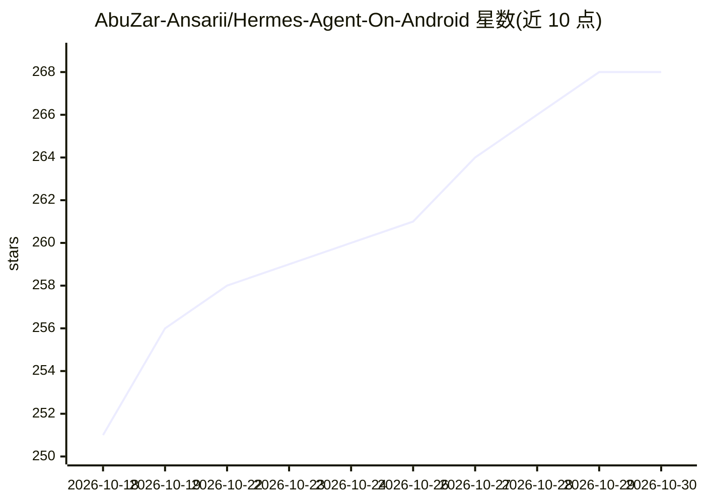

# AbuZar-Ansarii/Hermes-Agent-On-Android

⭐ 268 · Shell · 推送 2026-08-13 · [GitHub](https://github.com/AbuZar-Ansarii/Hermes-Agent-On-Android) · 个人维护

**在 Android Termux 上一键安装运行 Hermes Agent 的安装指南**

提供在 Android 设备 Termux 环境中部署 Nous Research 的 Hermes Agent（自进化 AI 助手框架）的一行式安装脚本，也给出手动安装步骤（pkg、git clone、proot-distro 进入 Ubuntu、venv、hermes setup）。README 附带 hermes 命令参考（交互模式、gateway、模型选择、文件上下文）、系统要求（Android 11+、2GB RAM、3GB 存储），并说明兼容 200+ 模型、可通过 pkg 安装 Ollama 跑本地模型。本体是安装/运行说明与脚本，Hermes Agent 本体由上游仓库提供。

## 筛选速览

| 维度 | 判定 | 备注 |
|---|---|---|
| AI 角色 | `ai-ecosystem` | LLM/agent 周边工具 |
| 许可风险 | `permissive` | — |
| 部署形态 | `None` |  |
| 模型依赖 | local-ok | 支持本地模型 |
| 硬件要求 | — | 无带数字的原话,不猜 |
| 安装摩擦 | `low` | 无编译、无系统依赖或容器化 |
| 成熟度 | — | 结构信号不足 |

## 能力要点

- 一行 curl 命令完成自动安装（另有手动步骤）
- 通过 proot-distro 的 Ubuntu 环境与 venv 运行 Hermes
- 兼容 200+ AI 模型，含 OpenAI/Anthropic/Google/DeepSeek/Qwen/GLM
- 可在 Termux 内安装 Ollama 运行本地模型

## 适用场景

- 把旧 Android 手机变成可随身携带的 AI 助手终端
- 在手机本地运行 Ollama 模型避免服务器费用
- 通过 hermes gateway 让手机接收 webhook/API 请求

## 场景标签

`AI 助手` · 领域:对话与助手

## 证据(README 行号)

> L35: ### **Copy and paste this command in Termux:**
> L76: ## 🛠️ Manual Installation
> L83: git clone https://github.com/AbuZar-Ansarii/Hermes-Agent-On-Android.git

## 星数曲线

2026-10-18 251 → 2026-10-30 268（+17）

---
*卡片 v1 · prompt 1.4 · 生成 2026-10-22 · 置信度 high · 依据 README sha `cfbbe1d9feeb` · [字段定义](../../DATASET.md)*
